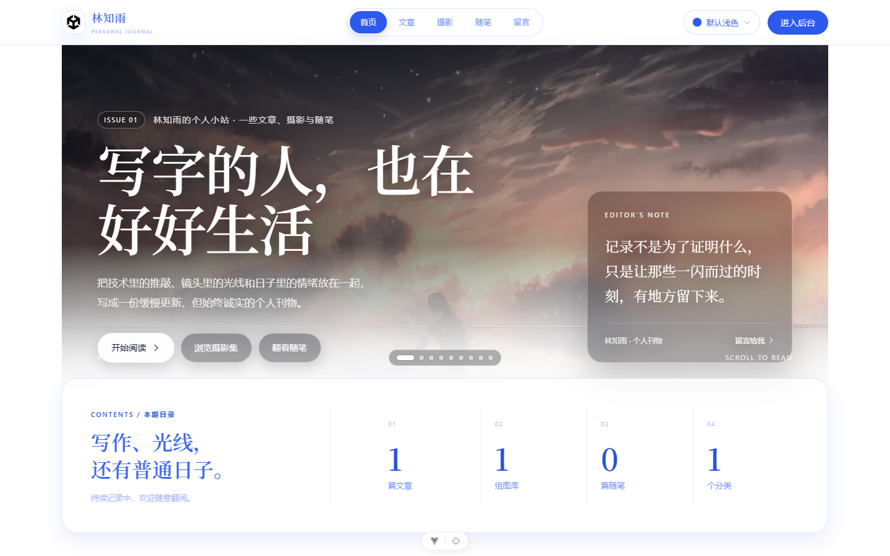
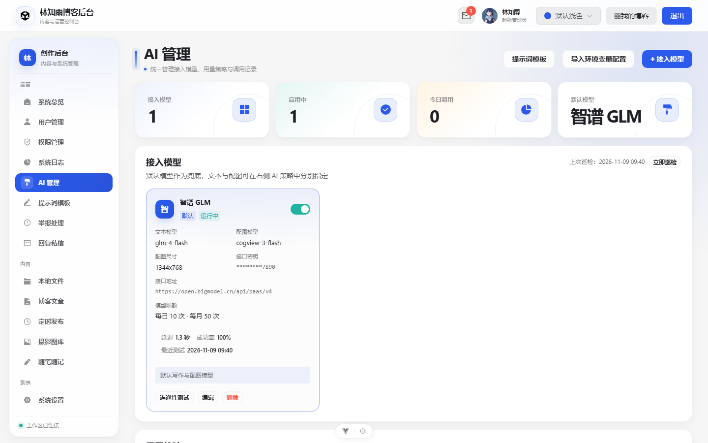
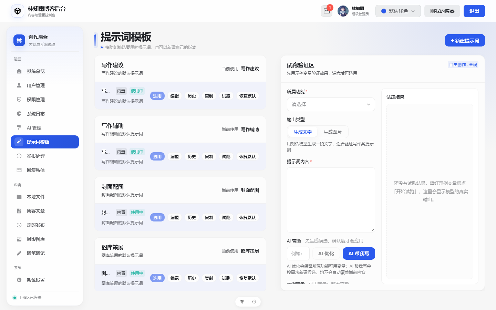

# LinBlog



LinBlog 是一套「前台门户 + 后台管理」一体化的个人博客系统，采用 Vue 3 + TypeScript 前端和 Express + MySQL 后端。访客可在无需登录的门户页浏览、检索、阅读已发布文章并查看公开评论；管理员在后台完成文章、摄影图库、本地文件、随笔、评论/私信、用户、分类/标签、AI 模型与权限的全流程管理。



## 核心特性

- **门户与创作后台一体化**：门户四页结构（首页 / 文章 / 摄影 / 随笔）+ 留言墙，详情以深链接弹窗展示；后台覆盖内容、素材、互动、统计、权限与系统设置。
- **完整内容工作流**：自动保存、预览、定时发布、版本历史、回滚、三方冲突对比与逾期告警。
- **AI 创作中台**：写作建议、润色 / 精简 / 扩写 / 续写、封面与配图生成、图片理解、图库策展、门户问答、语义搜索；模型可自由接入，文本与配图可分别路由。
- **提示词工作台**：内置与自定义提示词、AI 优化 / 生成候选、文字与图片试跑、历史版本回滚，试跑图片可存入素材库。
- **模型可治理**：多服务商接入、API Key 加密、用量配额、模型级限额、健康巡检、调用审计与系统日志。
- **安全与可恢复**：JWT、细粒度权限矩阵、同源校验、限流、数据库备份与隔离恢复演练、日志滚动清理与 CSV 导出。
- **SEO 与性能**：sitemap、RSS、robots、Open Graph、JSON-LD，图片按需 WebP 缩略图，门户 LCP 专项治理。



## 功能亮点

* **门户详情深链接、分享与 SEO**：文章、图库、随笔详情分别使用 `?open=<id>` 深链接，首页使用 `?article=`、`?gallery=`、`?diary=`，刷新、复制链接和浏览器前进/后退都能恢复对应详情；详情工具栏提供系统分享或复制链接。前端会按当前内容更新 title、description、canonical、Open Graph、Twitter Card 与 BlogPosting / ImageGallery JSON-LD，后台和登录页统一恢复 `noindex,nofollow`。后端新增 `sitemap.xml`、`robots.txt`、`feed.xml` 与公开随笔详情接口，生产环境建议配置 `LINBLOG_PUBLIC_URL`。
* **访客门户（四页结构）**：`/portal` 首页（Hero + 分类索引 + 最新文章 + 摄影照片墙 + 随笔卡片 + 标签云）、`/portal/articles` 文章归档（分类/标签筛选 + 关键词搜索 + 分页，筛选条件同步到地址栏）、`/portal/gallery` 摄影图库（CSS columns 瀑布流 + 分页 + 当前页详情弹窗）、`/portal/diary` 随笔（天气筛选 + 错落卡片墙 + 当前页详情弹窗）。文章、图库、随笔三个详情弹窗共用 `PortalCommentSection`，统一为两级评论：一级按时间倒序、二级回复默认收起可展开，支持评论点赞、回复、举报、删除（本人或管理员，需二次确认）与「回复 @某人」展示，点赞数和评论数实时回写列表卡片。匿名访客可正常阅读，互动时引导登录。四页共用 `PortalLayout` 顶栏/页脚，正文详情一律当前页弹窗，不跳转页面。配色全部取自主题变量，11 套预设与深浅色自动联动；无封面内容用主题色排印占位，移动端自适应。
* **评论举报可选择原因**：点击举报会弹出统一的举报弹窗（后台文章详情、后台图库/随笔评论区、门户评论区共用），提供 6 个原因（广告或引流、辱骂或攻击、色情或低俗、违法或危险、虚假或误导、其他原因）和选填的补充说明（最多 200 字）；原因会写入 `comment_report` 并记进系统日志。自己发表的评论不再显示举报项，后端也会拒绝举报本人评论。见 `lin_blog/src/components/content/CommentReportDialog.vue`、`serve/controller/commentInteractionController.js`。
* **后台举报处理**：侧栏「运营 → 举报处理」提供独立的举报工作台（权限 `comment.moderate`），并显示待处理数量角标。顶部展示近 14 天待处理/已处理/已忽略堆叠趋势与四张状态卡，支持时间范围、原因、来源（博客文章 / 摄影图库 / 随笔随记）与关键词筛选；可逐条或批量标记已处理/忽略，处理时可填写最多 200 字备注，也可在二次确认后删除评论。每条举报保留原因、补充说明、评论原文、作者、所属作品、举报人、累计举报次数与处理备注。见 `lin_blog/src/views/CommentReportView.vue`、`serve/controller/commentInteractionController.js`。
* **后台回复私信与留言隔离**：侧栏「运营 → 回复私信」提供会话工作台（权限 `message.private`），博主可查看并回复所有读者，其他账号只能在唯一会话中与博主沟通。顶栏私信抽屉中的每条消息可直接跳到对应会话；门户留言墙展示所有主动留言，以及每位用户向博主发送的第一条私信，后续普通聊天内容仅在后台会话中可见。页面可见时每 20 秒自动刷新顶栏数字未读徽标、私信抽屉和当前会话，收到新消息会在非当前会话弹出提示，历史位置则显示「新私信」按钮。见 `lin_blog/src/views/MessagesView.vue`、`lin_blog/src/components/reply/information.vue`、`lin_blog/src/utils/messageRealtime.ts`、`serve/model/dbModel/message/index.js`。
* **站内通知中心**：顶栏铃铛汇总当前账号收到的 `system` / `notice` 消息，支持未读角标、单条已读、全部已读与删除，未读数量与其他后台页面一样每 20 秒静默刷新。文章或随笔收到新评论时通知内容作者，回复评论时通知被回复的人，作者与回复目标重复时只发一条；AI 模型巡检连续失败和定时数据库备份失败也会写入站内通知。通知接口只要求登录，已读/删除只作用于本人收发的消息。见 `lin_blog/src/components/notification/NotificationDrawer.vue`、`lin_blog/src/components/bar/HeadBar.vue`、`serve/controller/messageController.js`、`serve/utils/commentNotification.js`。
* **图片按需缩略图**：`GET /api/uploads/:filename?w=320&format=webp` 用 sharp 在服务端按需生成 WebP 缩略图（白名单宽度 160–1600，不放大原图），带内存 LRU 缓存、并发请求合并、ETag/304 与长期浏览器缓存；列表卡片、详情大图与富文本正文都通过 `srcset`/`sizes` 按视口取合适尺寸，灯箱仍加载原图。旧图片无需重新上传。见 `serve/controller/uploadController.js`、`lin_blog/src/utils/imageOptimization.ts`。
* **11 套主题**：默认浅色/深色，叠加海洋蓝、森林绿、樱花粉、极光绿、落日橙、星云紫、黑曜石、午夜蓝、摩卡棕；`data-theme` 驱动组件明暗，`data-theme-preset` 注入品牌色与背景，选择持久化并在启动时恢复。

* **忘记密码与邮箱重置**：登录页「忘记密码?」打开弹窗，输入注册邮箱后后端签发一次性重置令牌（32 字节随机值，仅保存 SHA-256 哈希，30 分钟过期、单次使用）；SMTP 已配置时发送重置邮件，未配置时只在服务端控制台输出链接，绝不通过 API 返回。重置页 `/resetPassword?token=...` 校验令牌后展示用户名并允许设置新密码（至少 8 位），成功后清除本地登录态并跳回登录页。每个重置令牌绑定签发时的 `users.token_version`，手动改密或邮件重置后旧重置链接自动失效；JWT 携带 `tokenVersion`，改密或重置后递增数据库版本，旧登录令牌立即失效。请求重置邮件时，无论邮箱是否存在都返回相同提示，避免账号枚举；登录、重置申请、重置提交均有内存限流。SMTP 通过 `nodemailer`，配置见 `LINBLOG_SMTP_*` 系列环境变量。
* **后台全模块真实联调**：文章支持列表、新建、编辑、搜索、发布、撤回、删除及详情弹窗；日记支持天气图标与最多 6 张图片；图库分组与文章分组共用同一套分类数据。图库卡片下半部分、随笔卡片正文均可点击，打开后台详情弹窗查看大图/正文与两级评论区，管理员可在弹窗内直接删除评论；总览评论的删除同样带二次确认，删除一级评论会连同其下所有回复一起删除。三类卡片统计统一为「图标 + 数字」：浏览、喜欢、评论、回复（一级评论与回复由后端按 `parent_id` 分开统计）。总览页统计卡片、访问量折线图与设备/系统分布饼图均走真实接口；总览的评论条目可点击，按所属作品类型跳转到文章页或图库页并自动打开对应详情弹窗。
* **统一后台视觉与响应式体验**：侧栏按运营/内容/系统分组，图标、悬停态、焦点态和选中态统一；顶部保留主题下拉、私信数字未读徽标与用户入口。总览和用户管理复用 `StatCard`，支持配色、图标、点击筛选与当前筛选高亮；文件、图库和私信列表会按视口宽高动态计算每页数量，大屏下保持多行填充，不出现单行或大面积留白。图库编辑页左右卡片等高，评论分页固定在内容分隔线下方，图库初始化不会重复请求。列表分页统一走 `AdminPager`：它屏蔽了 yk-pagination 内部状态不同步导致的「数据翻页但高亮不跟手」，并统一提供「共 N 条」与每页条数切换；管理标签弹窗也接入该分页组件做前端切片分页。图库与随笔的删除确认使用 Teleport 到 body 的 `ConfirmPopover`，避免被卡片 `overflow: hidden` 裁剪。

* **内容创作工作流**：文章与摄影图库编辑页支持自动保存（停写 1.5 秒触发，只写工作稿不动线上内容）、发布前预览、定时发布与版本历史/回滚。已发布内容与编辑工作稿分离存储，读者不会看到半成品；多窗口同时编辑撞车时弹出三方对比（共同基线 / 本窗口 / 对方最新）后再决定采用谁。侧栏「定时发布」工作台按内容类型与账号可管理范围展示待发布队列，支持改期、立即发布、取消计划与逾期告警。详见 [Documentation/内容创作工作流.md](Documentation/内容创作工作流.md)。
* **定时发布以服务器时区为准**：计划时间的展示、解析与到期判定统一使用服务器时区，不再依赖浏览器时区。浏览器时区与实际挂钟不一致时（如容器 `TZ=UTC`、DevTools 时区覆盖），「1 小时后」依然得到正确时刻；后端另用 `GET /api/time/now` 把服务器时间与偏移下发给前端。
* **数据库备份与恢复演练**：图片以 `MEDIUMBLOB` 存在数据库里，附件目录备份无法恢复站点，因此服务内置数据库逻辑备份（每天定时导出 gzip JSONL、按保留份数自动清理），并提供「隔离恢复演练」——还原到 `linlog_drill_<随机>` 临时库校验后自动删库。后台「系统设置 → 系统信息 → 数据库备份」支持手动备份、下载、删除与清理过期。详见 [Documentation/数据库备份与恢复.md](Documentation/数据库备份与恢复.md)。
* **部署监控与安全加固**：`/healthz` 存活检查（不查库，避免 DB 抖动触发容器重启）、`/readyz` 就绪检查（DB 未连通返回 503）、`GET /api/health/runtime` 运行时信息（内存、运行时间、连接池占用）；公开写接口统一走同源校验中间件，前端带 CSP meta。连接池大小与获取超时可用 `LINBLOG_DB_CONNECTION_LIMIT` / `LINBLOG_DB_ACQUIRE_TIMEOUT_MS` 调整。
* **自动化回归与错误边界**：后端 527 项测试，前端 119 项纯函数单测，Playwright 73 条端到端回归，GitHub Actions 在 push/PR 时自动跑四层回归并上传报告。任一后台页面渲染异常时由 `ErrorBoundary` 兜住，展示可重试卡片而不是整站白屏；未捕获的异步异常统一进 `app.config.errorHandler` 落日志。

## 项目结构与当前状态

| 目录/模块 | 当前实现 |
| --- | --- |
| 门户详情与 SEO | 文章、图库、随笔详情支持 `?open=<id>` 深链接并同步浏览器地址栏；详情可分享，页面级 title / description / canonical / OG / Twitter / JSON-LD 随内容更新。后端提供 `/sitemap.xml`、`/robots.txt`、`/feed.xml`，并提供 `/api/seo/*` 反向代理别名。见 `lin_blog/src/utils/portalSeo.ts`、`lin_blog/src/components/portal/PortalShareButton.vue`、`serve/controller/seoController.js`。 |
| `lin_blog/` | Vue 3、TypeScript、Vite、Pinia、Vue Router、Yike Design；包含总览、用户管理、文章、图库、文件、日记及编辑页面。文章封面使用 `yk-upload`，详情 HTML 使用 DOMPurify 清洗。 |
| `serve/` | Express 5 API、JWT 认证、MySQL 数据模型；路由覆盖用户、文章、评论、消息、日记、文件、图片上传、上传票据、分类、标签和总览统计。 |
| `Documentation/` | 开发进度及数据库设计文档。 |
| 门户（访客前台） | 拆成四个独立页面：`/portal` 首页、`/portal/articles` 文章归档、`/portal/gallery` 摄影图库、`/portal/diary` 随笔，均匿名可访问。共用 `PortalLayout`（顶栏、页脚、`#app` 顶栏补偿）与 `PortalPhotoWall`（12 栏错落照片墙）；详情统一为当前页弹窗（`PortalArticleDetail` / `PortalGalleryDetail` / `PortalDiaryDetail`）。见 `lin_blog/src/views/Portal*.vue`、`lin_blog/src/components/portal/`、`lin_blog/src/style/portal.less`。 |
| 门户浏览量与热度 | 文章、摄影图库、随笔均支持真实浏览量统计：打开详情弹窗即计一次浏览，`view_log` 表按「登录用户 / 游客 IP+UA 哈希」做 30 分钟去重后自增 `article.views` / `diary.views`（同 NAT 出口下不同浏览器/设备可区分），计数回写列表卡片；三个归档页均提供「最新 / 最热」排序切换，`sort=hot` 走 SQL 排序而非前端重排。反向代理部署可用 `LINBLOG_TRUST_PROXY` 透传真实客户端 IP。见 `serve/controller/viewController.js`、`serve/model/dbModel/view/index.js`、`lin_blog/src/api/portal.ts`。 |
| 随笔天气筛选 | `/api/public/diary` 支持 `weather` 参数在 SQL 层过滤，翻页后筛选不失效；天气标签数量由后端全量统计后回传（`weatherFacet` / `facetTotal`），不再只统计当前页。筛选可与 `sort=hot` 叠加并同步到地址栏。见 `serve/model/dbModel/diary/index.js`、`lin_blog/src/views/PortalDiary.vue`。 |
| 主题系统 | 11 套可切换主题，双层变量（`data-theme` + `data-theme-preset`）驱动，选择持久化并在启动恢复，与顶栏明暗开关联动。见 `lin_blog/src/utils/themes.ts`、`lin_blog/src/utils/themePreset.ts`、`lin_blog/src/style/theme-presets.less`。 |
| 后台视觉与响应式 | `admin.less` 统一后台外壳、卡片、滚动区和大屏布局；`MenuBar` 分组导航，`StatCard` 可复用统计卡，`responsivePageSize` 处理文件、图库和消息列表分页。图库编辑左右等高，评论分页位于内容底线下方。见 `lin_blog/src/style/admin.less`、`lin_blog/src/components/common/StatCard.vue`、`lin_blog/src/utils/responsivePageSize.ts`。 |
| 用户管理 | 管理员用户列表/搜索/分页、创建、编辑、删除和启用/禁用已联调；统计卡（用户总数/管理员/编辑与普通用户/封禁用户）支持点击筛选与选中高亮，除总数外只统计启用用户。 |
| 文章 | 已完成列表、筛选、搜索、新建、编辑、发布、撤回、删除及当前页详情弹窗联调；新建入口位于总览/Gather 页面。图片上传到本地目录，文章 `cover` 字段保存访问 URL。 |
| 评论、消息 | 已接入真实 API：文章评论列表/两级回复/展开收起/删除、评论点赞与举报（举报需选择原因，本人评论不可举报）、举报数展示、后台举报处理页（原因/来源/状态/时间筛选、14 天趋势、待处理角标、单条或批量处理、处理备注、删除评论）、私信会话回复、一键已读、顶栏数字未读徽标与私信跳转均可用；页面可见时每 20 秒自动刷新会话和未读数，非当前会话新消息有提示，滚动到历史位置时可点击「新私信」回到最新；门户留言墙展示所有留言与每位用户的首条私信，后续聊天不会二次公开；前台与后台文章详情共用同一套评论互动能力。 |
| 文件 | 本地文件已接入数据库：上传（多选、单文件 20MB 上限）、图片/文件/视频/压缩包分组、批量移动与删除、下载与缩略图。文件里的图片可直接复用到文章封面、摄影图库与随笔（「从素材库选择」），被内容引用的文件不会被删除。 |
| 存储维护 | 回收站弹窗提供存储维护面板：缩略图 LRU 缓存命中率、缓存占用进度条、变体条数与生成次数，磁盘文件 / 内容图片 / 回收站的占用分布；管理员可一键清理缩略图缓存，下次请求按需重新生成。 |
| 图库 | 摄影图库已接入数据库：图片集创建/编辑/发布/撤回、瀑布流展示、分组与文章分组共用（分组仅在文章页维护）。 |
| 内容创作工作流 | 文章与图库编辑页支持自动保存（停写 1.5 秒触发，只写工作稿不动线上内容）、发布前预览、定时发布（30 秒轮询到点自动应用工作稿并发布）与版本历史/回滚。「安排定时发布」弹窗提供快捷时间预设、已计划状态块（当前计划 + 倒计时 + 就地取消）与人读时间预览，时间过近会内联提示并禁用确认。自动快照按 5 分钟合并、只留近 24 小时与最近 50 条；手动/发布/回滚/定时快照长期保留，回滚生成新工作稿不覆盖历史。工作稿与已发布内容分离在 `article.draft_*` 字段，乐观锁用 `draft_revision` 防多窗口覆盖；冲突时提供三方对比弹窗（对方与本窗口相对共同基线的字段/正文差异），可选择采用对方版本或保留本窗口修改覆盖保存。**新建页还没有后端 ID**，因此先把内容暂存到 `localStorage`（刷新/崩溃后可恢复），创建成功后自动清除；列表卡片回传 `hasUnpublishedChanges` / `scheduledAt`，直接显示「有未发布修改」与「定时发布」角标。新增侧栏「内容 → 定时发布」工作台，按账号作用域汇总文章与图库待发布队列，支持类型筛选、改期、立即发布、取消计划和逾期告警。见 `serve/model/dbModel/articleWorkflow/index.js`、`serve/utils/articleScheduler.js`、`lin_blog/src/utils/localDraft.ts`、`lin_blog/src/views/ScheduledPublishView.vue`、`lin_blog/src/views/EditArticle.vue`、`lin_blog/src/views/EditGallery.vue`、`Documentation/内容创作工作流.md`。 |
| 日记 | 随笔随记已接入数据库：天气图标字典与前端对齐（8 种）、图片上限 6 张、按天记录；公开列表支持按天气名在 SQL 层过滤。 |
| AI 写作建议 | 文章编辑器提供「AI 建议」「AI 润色 / 精简 / 扩写 / 续写」与「AI 生成封面」入口，随笔与摄影图库编辑页提供「AI 生成配图」入口：按标题与正文生成简介、标签、写作候选文本或封面/配图插画，**只作建议**，作者点「采用」后才写入表单、编辑器、封面或配图列表（也可直接忽略）。服务端代理 OpenAI 兼容接口与智谱 CogView 图片接口，密钥只存服务端环境变量；模型未配置时入口隐藏、接口返回 503，站内其他功能不受影响。默认模型遇到超时、限流或服务端故障时，后端会按候选模型自动降级，并在结果中提示实际生效模型。写作候选不落库；图片候选暂存服务端内存（10 分钟、一次性 token），确认后才走与上传同一条持久化路径写入 image 表。三处「从素材库选择 / AI 生成」入口统一由 `ImageSourceActions` 组件渲染，样式与交互一致。见 `serve/utils/aiClient.js`、`serve/controller/aiController.js`、`lin_blog/src/components/common/ImageSourceActions.vue`。 |
| 门户 AI 问答 | 门户首页提供「站内问一问」入口。系统先只检索已发布的文章、图库与随笔内容，检索不到时直接提示且不消耗模型调用；有可用片段后由 AI 依据站内片段生成答案，并只回传实际引用的来源链接。匿名访客接口单独限流，不占用后台用户 AI 配额。见 `serve/controller/aiController.js`、`lin_blog/src/components/portal/PortalAskBox.vue`。 |
| AI 图库策展 | 摄影图库编辑页提供「AI 策展建议」入口：可补充一句主题（如「清晨海岸」），AI 结合当前标题、简介与照片数量给出 3 个候选标题、一段策展简介和 2-4 个标签。标题、简介、标签**逐项采用**，不会自动覆盖作者已写的内容，未采用的候选标题可继续改选。整个过程与其它 AI 入口一致：走 `ai.use` 权限、计入次数配额、写入系统日志，默认模型故障时自动降级。见 `serve/utils/aiClient.js`、`serve/controller/aiController.js`、`lin_blog/src/components/forms/forms.vue`。 |
| 门户语义搜索 | 文章归档页搜索框旁新增「语义搜索」开关：开启后 AI 先把自然语言查询扩展成 2-5 个近义关键词，再在**已发布**内容里做加权检索（标题命中权重最高，简介、标签、正文依次降低），页面展示扩展出的关键词与命中结果。模型不可用时自动退化为普通关键词检索，搜索失败也回退到原有关键词列表，不会出现空白页。访客可匿名使用，走独立频率限制，不占用后台账号 AI 配额，扩展关键词的调用会写入系统日志。见 `serve/utils/aiClient.js`、`serve/model/dbModel/article/index.js`、`serve/controller/aiController.js`、`lin_blog/src/views/PortalArticles.vue`。 |
| AI 私信助手 | 私信工作台的输入框上方新增「AI 拟回复」入口（需 `ai.use` 权限）：读取当前账号与对方的最近 10 条对话，生成两条语气不同的候选话术（热情友好 / 简洁克制）。**只作建议**——点「采用」仅把话术写进输入框，发送动作仍需作者自己点击「发送」；切换会话会清空上一段对话的建议，避免用错上下文。服务端只取当前双方之间的私信，其它人的消息不会进入提示词；无 `message.private` 权限时接口拒绝。见 `serve/utils/aiClient.js`、`serve/controller/aiController.js`、`serve/model/dbModel/message/index.js`、`lin_blog/src/views/MessagesView.vue`。 |
| AI 运营周报 | 「AI 管理」页新增「运营周报」面板，可切换近 7 天 / 近 30 天：服务端先从数据库聚合真实统计（页面访问、独立访客、移动端访问、新增文章与图库、新增评论与私信、热门路径、AI 调用量），页面先展示这些数字，再由模型把数字组织成 3-4 个文字小节（本周概况 / 内容表现 / 互动情况 / 下周建议）。提示词明确要求只用给定数字、不编造对比结论，报告只是给作者参考的建议，不会自动发布或修改任何内容。需 `overview.viewAll` 权限。见 `serve/model/dbModel/record/index.js`、`serve/utils/aiClient.js`、`serve/controller/aiController.js`、`lin_blog/src/views/AiManageView.vue`。 |
| AI 内容标记 | 文章、图库与随笔在作者实际「采用」AI 建议、写作候选、封面或配图后，按环节记录 `AI 辅助` 标记（建议 / 写作 / 封面 / 配图）；列表卡片可查看标记概览，作者保存内容时由服务端白名单归一化并写入 `article.ai_assisted` / `diary.ai_assisted` 等字段，方便后续区分和二次润色。见 `lin_blog/src/utils/aiMarker.ts`、`serve/controller/articleController.js`、`serve/controller/diaryController.js`、迁移 `20261115_ai_content_marker`。 |
| AI 提示词模板 | 提示词模板从「AI 管理」拆成独立的「提示词模板」页（路由 `/aiPrompt`，需 `ai.manage`）：按功能分组（写作建议、写作辅助、封面配图、图库策展、门户问答/搜索、私信回复、运营周报、举报辅助、自由创作、AI 提示词助手共 11 类），每条模板只占一行，正文改为弹窗编辑，不再每条都摊开一个大文本框。除了改内置模板，还可以**新建自己的提示词**（挂在任一功能下）、一键复制现有模板当草稿、随时**选用**某个功能当前用哪一条；内置模板可恢复默认但不可删除，自定义模板可删除。页面改为**左右双栏**：左侧是可滚动的模板区（各功能分组之间留出间距，宽度一致），右侧是**试跑验证区**——可以改提示词内容、填示例变量（`变量名=示例内容`）后直接试跑，配图类模板出图片、其余出文本，效果满意再点「选用此套提示词」。**所属功能用中文下拉框选择**，不再暴露英文 featureKey，并新增「自由创作」选项用于随手测试提示词效果；未保存的草稿也能先试跑，不满意就不会污染模板列表。「AI 提示词助手」也是内置模板，可编辑、启停、恢复默认与选用；AI 生成候选时会按当前选用模板渲染。试跑是真实模型调用，因此计入 AI 次数配额并写入调用记录与系统日志（功能标识 `prompt-preview`）。服务端模板落 `ai_prompt_template`（迁移 `20261116_ai_prompt_template` / `20261117_ai_prompt_custom` / `20261118_ai_prompt_seed` / `20261121_ai_prompt_assistant_seed`），功能选用关系落 `ai_prompt_binding`；调用时按「选用的模板 → 启用的内置模板 → 代码内置提示词」逐级回退，选用的模板被停用或删除后自动回退，模板为空或变量为空时不会给模型发无效占位符。见 `serve/utils/aiPromptTemplates.js`、`serve/utils/aiClient.js`、`serve/controller/aiManageController.js`、`lin_blog/src/views/AiPromptView.vue`。 |
| AI 图片去水印与存入本地文件 | 所有 AI 出图入口（文章封面、随笔配图、图库配图、提示词试跑）默认去掉右下角「AI生成」徽标，且**可在「AI 管理 → AI 策略」里随时开关与切换方式**：①「去除「AI生成」标识」总开关，关闭后图片保持服务商原样；②「去除方式」二选一——**裁掉角落**（只裁右下角，成图尺寸略变小，如 1344x768 → 约 1197x701）或**裁剪后缩放回原尺寸**（裁完再缩放回原始尺寸，画幅保持不变，画面有轻微拉伸）。请求层始终带 `watermark_enabled: false`（账号签署过智谱「去水印免责声明」后由服务商直接生效），未签署时由服务端按徽标几何（文字高度约为图高 3.65%、紧贴右下角）定位并把右下角整块裁掉。提示词试跑区另有「存入本地文件」按钮：试跑满意的图片点一下即可落进本地文件素材库（image 表 + 「内容图片」聚合行，与普通上传同一条持久化路径），并写入系统日志；该操作只落库、不再调用模型，因此不计入 AI 次数配额。策略落在 `ai_setting` 单行配置（迁移 `20261119_ai_image_process`）。见 `serve/utils/aiWatermark.js`、`serve/utils/aiClient.js`、`serve/controller/aiManageController.js`、`lin_blog/src/views/AiManageView.vue`。 |
| AI 举报辅助 | 举报工作台每条待处理举报新增「AI 辅助判断」入口（需 `ai.use` + `comment.moderate` 权限）：AI 结合举报原因、读者补充说明、被举报评论原文、评论作者、所属内容与累计被举报次数，给出「是否成立 / 更贴切的原因 / 建议处置 / 一段处理备注」。**只是建议**——不会自动改处置状态，「带入备注」也只把备注文字填进处理弹窗，仍要运营自己确认并保存。模型输出的原因与处置取值会被收敛到站内既有枚举（6 类原因、3 种处置），非法值一律落到安全默认。见 `serve/model/dbModel/commentInteraction/index.js`、`serve/utils/aiClient.js`、`serve/controller/aiController.js`、`lin_blog/src/views/CommentReportView.vue`。 |
| AI 管理与配额 | 侧边栏新增「AI 管理」（需 `ai.manage` 权限）：可自定义接入模型（名称、接口地址、密钥、文本模型、配图模型与尺寸、超时），支持启停、设为默认、连通性测试与删除；密钥用 AES-256-GCM 加密入库、列表只回传掩码。**AI 策略新增「模型分工」**：文本模型与配图模型可以分别指定（例如文本用魔搭、配图用智谱），留空时跟随默认模型；所选模型停用或缺少对应能力时自动回退。`.env` 里的 `LINBLOG_AI_*` 配置会由迁移 `20261110_ai_env_import` 自动导入为默认模型，页面也提供「导入环境变量配置」按钮随时同步；模型名称按接口域名自动识别服务商（如 `open.bigmodel.cn` 识别为「智谱 GLM」）。用量策略可配置「是否启用次数限制 / 每用户每日上限 / 每用户每月上限 / 超级管理员是否不限」，默认每用户每日 20 次、每月 100 次，0 表示不限。另可给单个模型设置更严的每日/每月上限（不能高于全局上限），命中时返回 429 并指明是哪个模型。页面上方新增「用量统计」面板：三个时间窗口的总览（调用量、成功率、平均耗时、token 消耗）、按模型与按功能分组、每日趋势、待确认图片占用与模型健康状态（连通性测试的耗时、成功率、连续失败次数）。AI 封面与配图的候选图片改为入库暂存，多实例部署时「生成」与「采用」可在不同进程完成，令牌与生成者绑定。非超级管理员需 `ai.use` 权限才能调用 AI，命中上限直接返回 429 并说明剩余额度；每次调用都会写入系统日志（模块 `ai`）与 AI 调用记录表，可在管理页查看近期调用。见 `serve/controller/aiManageController.js`、`serve/middleware/aiQuota.js`、`serve/utils/aiUsageLogger.js`、`lin_blog/src/views/AiManageView.vue`。 |
| 总览 | 四张统计卡片（文件总大小、文章、图库、日记数量）走聚合接口 `GET /api/overview/summary`；访问量折线图与设备/系统分布饼图走 `GET /api/overview/visitStats`，近一周/近一月切换相互独立。 |
| 总览 · 热门路径 | `GET /api/overview/topPaths` 返回近 N 天访问次数 TOP N 的路径（`period=week\|moon`、`limit` 1–50），前端在访问量折线下方以排名条形 + 人读路径（如「文章 #123」）呈现，配合迁移 `20261101_composite_indexes` 补的复合索引避免全表扫描。 |
| 自动化回归与 CI | `.github/workflows/ci.yml` 在 push / PR 到 `main` 时并行跑四个 job：后端单测、前端单测与生产构建、真实 MySQL 集成测试（起独立 MySQL 8.0 服务，自动建库跑迁移、跑完删库）、Playwright E2E，并上传 `playwright-report/`、`test-results/` 产物。E2E 用 `page.route` 拦截 `/api/**` 返回稳定 mock，不依赖 MySQL 与后端进程。 |
| 部署监控与安全加固 | `/healthz` 存活检查、`/readyz` 就绪检查（DB 未连通返回 503）、`GET /api/health/runtime` 运行时信息；公开写路由挂 `sameOrigin` 同源校验中间件；`index.html` 带 CSP meta。`serve/middleware/sameOrigin.js`、`serve/utils/healthCheck.js`。 |
| 错误边界 | `lin_blog/src/components/common/ErrorBoundary.vue` 以 `onErrorCaptured` 拦截路由级渲染/生命周期异常，`App.vue` 用 `:key="route.path"` 包住 `<router-view>`，崩页时展示可重试卡片；错误详情格式化与可重试判定收敛在 `lin_blog/src/utils/errorBoundary.ts`。 |
| 数据库备份与恢复 | 定时导出 gzip JSONL 逻辑备份（不依赖 `mysqldump`），按外键顺序序列化、`BLOB` 十六进制编码并按字节切块；支持隔离恢复演练、`scripts/verify-restore.js` 逐表行数与图片 SHA-256 核对。见 `serve/utils/dbBackup.js`、`serve/model/dbModel/backup/index.js`。 |

### 本地开发命令

前端在 `lin_blog/` 目录安装项目依赖后，可使用：

```sh
npm run dev
npm run build
npm test
npm run test:e2e          # Playwright 端到端回归（需先 npm run test:e2e:install）
```

`build` 会先执行 `vue-tsc -b` 类型检查，再运行 Vite 构建。2026-10-27 本地验证构建通过；已安装 `vite-plugin-html`、`vite-plugin-vue-devtools` 与 `@types/node`，补齐 Vite 配置所需依赖和 Node 类型。MockJS 已移除，`eval` 警告消失。经图标按需注册与 echarts 特性裁剪后，`yike-design` 与 `echarts` 已压到阈值内，`chunkSizeWarningLimit` 为 600；`editor` 经两轮裁剪已从约 812 KB 降到约 538 KB（gzip 约 185 KB），不再超阈值，详见 [Documentation/开发进度.md](Documentation/开发进度.md)。

后端在 `serve/` 目录执行：

```sh
npm test
npm run db:migrate
npm run db:seed
npm start
```

`serve/.env.example` 提供 JWT、数据库连接、CORS、JSON 请求体限制、备份容量、跨盘镜像与 S3 兼容对象存储的配置模板；`serve/linlog.js` 会通过 Node.js 的 `loadEnvFile` 加载 `.env`。`LINBLOG_JWT_SECRET` 至少需要 32 个字符。前端 Vite 开发服务器将 `/api` 代理到 `http://localhost:3030`。

#### 自动化测试与 CI

三层回归均可本地复现：

```sh
npm --prefix serve test          # 后端模型/控制器单测（使用模型替身）
npm --prefix lin_blog test       # 前端纯函数与路由守卫单测
npm --prefix lin_blog run test:e2e   # Playwright 端到端（自动拉起 Vite dev server）
```

E2E 覆盖 53 条主链路：登录与权限守卫、评论举报（选原因与补充说明、未选原因禁止提交）、私信回复、私信轮询（未读徽标与其他会话新消息提示）、主题切换持久化、门户详情深链接、门户留言墙（展示与提交回显）、举报处理工作台（全选批量标记已处理并带备注、日期筛选与单条备注处理）、权限矩阵只读模式、门户 Hero 的 img + srcset + preload（含窄屏选 960 档）、编辑器代码块高亮（CSS/HTML/JavaScript 产生 token、未收录语言只失去着色、语言菜单可切到 JavaScript）、后台内容流（文章撤回发布与删除、关键词搜索带上 keyword 参数、图库列表渲染并进入编辑页、随笔新建与删除）、内容工作流（文章/图库自动保存、预览、版本面板、定时发布、列表角标、新建页恢复、保存冲突三方对比）、AI 写作建议与写作辅助（简介/标签、润色替换选区、续写、文章封面、随笔配图与图库配图均只在作者确认后写入，忽略则不改动原内容）、AI 管理（接入模型列表与掩码密钥、用量策略保存、调用记录展示、接入模型弹窗的三段分组与密钥明文切换、从环境变量导入、健康巡检与提示词模板、无 `ai.manage` 权限时侧边栏不出现入口）、素材库复用（图库从素材库挑选本地图片并写入工作稿）、本地文件混排（内容图片与磁盘文件同列表展示、归属区块与内容名称标签、点击卡片选中不弹预览、回收站存储维护面板与缓存清理）、定时发布工作台（逾期告警、改期、立即发布、取消计划）、错误边界（正常路径不拦截渲染）与定时发布跨时区回归（浏览器时区分别为 Asia/Shanghai / UTC / Etc/GMT+2 时，「1 小时后」均得到服务器时区的同一时刻）。所有 `/api/**` 请求由 `lin_blog/e2e/fixtures/mockApi.ts` 拦截并返回稳定 mock，测试不依赖 MySQL 或后端进程；未显式 mock 的接口统一兜底为空成功响应，避免误连 `localhost:3030`。首次运行需执行 `npm --prefix lin_blog run test:e2e:install` 下载 Chromium；公司网络下载慢时可设置 `PLAYWRIGHT_CHANNEL=chrome` 复用本机安装的 Chrome。

`.github/workflows/ci.yml` 在 push / PR 到 `main` 时并行执行后端单测、前端单测与生产构建、真实 MySQL 集成测试、Playwright E2E 四个任务，并上传 `playwright-report/` 与 `test-results/` 作为构建产物。见 `lin_blog/playwright.config.ts`、`lin_blog/e2e/`。

#### CORS 跨域配置

`LINBLOG_ALLOWED_ORIGINS` 必须列出实际访问前端的完整来源（协议、域名和可选端口），多个来源用英文逗号分隔，例如 `http://localhost:5173,https://blog.example.com`。不要配置路径、尾部斜杠或通配符；来源格式无效或变量缺失时，服务会在启动配置阶段给出明确错误并退出。后端允许 `Authorization` 请求头以及 `GET/POST/PUT/PATCH/DELETE` 等实际使用的方法，`OPTIONS` 预检由 CORS 中间件在路由前处理。生产部署应只填写可信前端来源，并通过部署平台的环境变量管理密钥。

**数据库安全提示：** 后端启动会幂等创建数据库和表，并执行 `schema_migrations` 中尚未应用的增量迁移，但不会自动插入演示数据。需要演示数据时显式执行 `npm run db:seed`；该脚本在 `users` 表已有数据时跳过。对有价值的数据仍应先备份并在隔离环境验证迁移。

#### Railway 单服务部署

根目录提供 `Dockerfile` 与 `railway.toml`，生产环境由 Express 同时托管 `lin_blog/dist`、`/api`、SEO 路由和上传文件，因此不需要分别部署前后端，也不需要先购买域名。Railway 生成的 HTTPS 二级域名可直接作为 `LINBLOG_PUBLIC_URL` 和 `LINBLOG_ALLOWED_ORIGINS`。

Railway 会自动注入 `PORT` 与 `RAILWAY_PUBLIC_DOMAIN`；MySQL 插件提供的 `MYSQLHOST/MYSQLPORT/MYSQLUSER/MYSQLPASSWORD/MYSQLDATABASE` 也受支持。文件模块需要在 Railway 挂载 `/data` 持久化磁盘，并设置 `LINBLOG_FILE_STORAGE_DIR=/data/files`、`LINBLOG_FILE_BACKUP_DIR=/data/file-backups`。完整步骤见 [Documentation/Railway部署.md](Documentation/Railway部署.md)。

#### 部署校验清单

上线前按下面逐项确认；`serve/config/default.js` 会拦截致命配置错误，`serve/linlog.js` 还会在启动时打印不会阻断运行的环境告警：

- `LINBLOG_JWT_SECRET` 至少 32 位随机值，且不要与测试环境复用。
- `LINBLOG_ALLOWED_ORIGINS` 只填写真实前端来源（协议 + 域名 + 可选端口），生产环境建议同时显式设置 `LINBLOG_PUBLIC_URL`。
- 反向代理后开启 `LINBLOG_TRUST_PROXY`，否则访问统计与登录限流会按代理 IP 归并。
- 持久化目录已挂载：`LINBLOG_FILE_STORAGE_DIR`、`LINBLOG_FILE_BACKUP_DIR`、`LINBLOG_DB_BACKUP_DIR`；Railway 建议统一放到 `/data` 下。
- SMTP 已配置并完成一次真实发信测试；未配置时密码重置链接只写服务端日志，`LINBLOG_AI_ALERT_EMAIL` / `LINBLOG_BACKUP_ALERT_EMAIL` 也不会投递。
- `/healthz` 返回 200、`/readyz` 在数据库可用时返回 200；部署平台健康检查优先使用 `/healthz`，避免数据库抖动触发重启。
- 至少执行一次手动数据库备份，并确认 `db_backup_log` 有记录；定时备份默认每天 03:00，成功/失败都会进入备份历史与系统日志。
- AI 为可选能力：未配置 `LINBLOG_AI_*` 时可在后台「AI 管理」接入模型；启用后确认模型健康巡检、每日配额与提示词模板均符合预期。
- 登录保护默认同一账号连续失败 5 次锁定 10 分钟，可通过 `LINBLOG_LOGIN_MAX_FAILURES` / `LINBLOG_LOGIN_LOCK_MINUTES` 调整。

### 已注册的后端 API

| 模块 | 路由 | 认证/说明 |
| --- | --- | --- |
| SEO 与订阅 | `GET /sitemap.xml`、`GET /robots.txt`、`GET /feed.xml`（另提供 `/api/seo/*` 别名） | 公开访问；sitemap 收录门户归档和已发布文章、图库、随笔详情，RSS 合并三类内容并按发布时间倒序，robots 屏蔽后台并声明 sitemap。站点来源优先使用 `LINBLOG_PUBLIC_URL`。 |
| 用户管理 | `PUT /api/user/updateUser/:id`、`DELETE /api/user/deleteUser/:id`、`PUT /api/user/updateUserStatus/:id` | 管理员操作，需要认证。 |
| 用户 | `GET /api/user/isRegistered`、`POST /api/user/register`、`POST /api/user/login`、`POST /api/user/password/reset/request`、`GET /api/user/password/reset/validate`、`POST /api/user/password/reset` | 注册、登录和忘记密码公开；重置令牌一次性、30 分钟过期、单次使用。 |
| 用户 | `POST /api/user/userInfo`、`POST /api/user/allUser`、`POST /api/user/createUser` | 需要 Bearer Token；用户列表和管理员创建用户仅管理员可操作。 |
| 文章 | `POST/GET /api/article`、`GET/PUT/DELETE /api/article/:id`、`PATCH /api/article/:id/status` | 需要 Bearer Token；列表支持分页、状态、类型和分类筛选。 |
| 公开只读（门户） | `GET /api/public/article`（支持 `classify=article|image`）、`GET /api/public/article/:id`、`GET /api/public/comment?articleId=...`、`GET /api/public/subset`、`GET /api/public/label`、`GET /api/public/diary`（支持 `weather` 按天气名过滤、`sort=hot` 按浏览量排序，并回传 weatherFacet 分面计数）、`GET /api/public/diary/:id` | 无需登录；无论是否携带 Token，都只能读取已发布文章、对应正常评论、分类/标签列表与状态正常的随笔，门户不会因登录而切回后台作者视角。 |
| 门户互动（需登录） | `POST /api/public/comment`、`POST /api/public/comment/like`、`POST /api/public/comment/report`（新增 `reason`、`detail?`）、`POST /api/public/comment/delete`、`GET /api/public/praise/:id`、`POST /api/public/praise/:id` | 评论、评论点赞/举报/删除与文章点赞需登录，匿名返回 401；点赞状态可匿名读取。只能互动已发布内容，回复仅支持两级，同一用户重复举报同一评论不重复计数。举报必须选择有效原因（`spam`/`abuse`/`porn`/`illegal`/`misinformation`/`other`），补充说明最多 200 字，举报本人评论返回 400。删除按 `commentType` 分发文章评论与随笔评论，仅本人或管理员可删，并同步回退所属内容的冗余评论计数。 |
| 随笔互动（公开） | `GET/POST /api/public/diary/praise/:id`、`GET/POST /api/public/diary/comment` | 点赞状态与评论可匿名读取，点赞与发表评论需登录（匿名返回 401）；点赞/取消在事务内同步 `diary.likes`，评论同步 `diary.comments`。 |
| 门户浏览计数 | `POST /api/public/view` | 匿名可调用；按「登录用户 / 游客 IP+UA 哈希」去重（30 分钟窗口），只统计已发布文章、图库与正常状态随笔，返回回读后的浏览量。 |
| 图片上传 | `POST /api/upload/ticket`、`POST /api/upload/image?ticket=...`、`GET /api/uploads/:filename`（支持 `?w=160\|240\|320\|480\|640\|720\|960\|1280\|1600&format=webp`） | 上传需要认证，支持 JPG、PNG、WebP、GIF，单文件不超过 8 MB；返回的 URL 可通过静态路由公开访问。带 `w`/`format` 时返回按需生成的 WebP 缩略图（不放大原图，带 ETag/304），宽度不在白名单时返回 400，生成失败回退原图。 |
| 评论 | `GET/POST /api/comment`、`DELETE /api/comment/:id`、`GET /api/comment/my`、`GET /api/comment/reports`、`PATCH /api/comment/reports/:id`、`PATCH /api/comment/reports/batch` | 需要 Bearer Token；`GET /api/comment` 支持可选 `articleId` 过滤，后台文章详情用它只拉取本篇评论；回复仅支持两级。举报列表与处理接口需 `comment.moderate`，支持 `status=0\|1\|2\|all`、`reason`、`targetType=article\|gallery\|diary`、`keyword`、成对的 `startDate`/`endDate` 过滤，并回传 14 天趋势；处理支持 1 已处理 / 2 已忽略与最多 200 字的 `note`，批量接口一次接收 1–200 个 `ids`，已处理举报可通过 `status=0` 恢复为待处理并清空处理信息。 |
| 消息 | `POST /api/message`、`GET /api/message/inbox`、`GET /api/message/outbox`、`GET /api/message/conversations`、`GET /api/message/conversation/:userId`、`GET /api/message/notifications`、`GET /api/message/notifications/unread/count`、`PATCH /api/message/notifications/read-all`、`PATCH /api/message/read`、`DELETE /api/message/:id`、`GET /api/message/unread/count` | 收件箱、发件箱与会话列表需要 Bearer Token 与 `message.private`；通知列表、未读通知数、全部已读和单条已读/删除只要求登录，且只能操作本人收发的消息。会话列表对博主返回全部读者，对其他账号固定返回与博主的单会话；普通账号只能给博主发私信。公开留言墙展示所有 `wall` 留言以及每位用户的首条私信，后续聊天不会公开。 |
| 日记 | `GET/POST /api/diary`、`GET/PUT/DELETE /api/diary/:id` | 需要 Bearer Token；天气按名称匹配前端字典，图片最多 6 张。 |
| 文件 | `GET /api/file`、`GET /api/file/summary`、`GET /api/file/images`（素材库图片）、`GET /api/file/trash`、`PATCH /api/file/restore`、`DELETE /api/file/trash`（仅管理员，彻底删除）、`GET /api/file/storage/status`（仅管理员）、`POST /api/file/maintenance/cleanup`（仅管理员，支持 `dryRun`）、`POST /api/file/upload?ticket=...`、`PATCH /api/file/move`、`DELETE /api/file`、`GET /api/file/:id/download`、`GET /api/file/:id/raw`、`GET /api/file/maintenance/stats`（存储维护统计）、`POST /api/file/maintenance/cache`（清空缩略图缓存，均需 file.purge） | 上传需要认证（一次性票据）；删除为软删并把本地文件移入非公开备份区，可在回收站恢复或由管理员彻底删除；下载公开，缩略图加 `?inline=true`。`/api/file/:id/raw` 是图片的公开内联地址，支持 `?w=&format=webp` 缩略图契约，可被文章/图库/随笔直接引用；仍被内容引用的文件不允许删除或彻底清除。 |
| 分类 | `GET /api/subset?classify=...`、`POST /api/subset`、`PUT /api/subset/:id`、`DELETE /api/subset/:id` | 需要认证；图库（`classify=image`）复用文章分组，仅计数口径不同。门户 `GET /api/public/subset` 的分类计数只统计已发布内容，草稿与已驳回不计入。 |
| 标签 | `GET/POST /api/label`、`DELETE /api/label/:id` | 需要认证；标签被文章引用时禁止删除。 |
| 总览统计 | `GET /api/overview/summary`、`GET /api/overview/visitStats?period=week\|moon`、`GET /api/overview/topPaths?period=week\|moon&limit=1-50` | 需要 Bearer Token；summary 聚合文件总大小、文章/图库/日记数量、评论数与私信未读数，visitStats 返回每日访问量与设备/系统分布，topPaths 返回热门路径 TOP N（按访问次数降序，默认 10、上限 50）。 |
| 服务器时间 | `GET /api/time/now` | 公开访问，`Cache-Control: no-store`；返回服务器绝对时间 `now`、时区偏移 `offsetMinutes` 与时区名 `timeZone`。定时发布等「本地时间」语义以该接口为权威，前端据此解析 `datetime-local`，不依赖浏览器时区。 |
| 健康检查与运行时 | `GET /healthz`、`GET /readyz`、`GET /api/health/runtime` | `/healthz` 存活检查不查库（避免 DB 抖动触发容器重启）；`/readyz` 就绪检查带 5 秒 DB ping 缓存，未连通返回 503；`/api/health/runtime` 需 `systemLog.view`，返回内存、运行时间、连接池占用与 Node 版本。 |
| 系统日志 | `GET /api/systemLog` | 仅管理员；记录登录与各模块写操作（创建/更新/删除、目标类型与 IP），支持分页、关键词搜索与时间排序（`sortOrder=asc|desc`，默认 `desc`）。 |
| 数据库备份 | `GET /api/backup`、`GET /api/backup/history`、`POST /api/backup`、`GET /api/backup/:filename/download`、`POST /api/backup/restore-drill`、`POST /api/backup/prune`、`DELETE /api/backup/:filename` | `backup.view` 可查看总览与历史，`backup.manage` 才能备份、下载、删除、清理与演练；恢复演练还原到隔离临时库并在验证后自动删库。 |
| 内容工作流 | `GET /api/article/scheduled`、`GET /api/article/:id/workflow`、`POST /api/article/:id/workflow/draft`、`GET /api/article/:id/versions`、`GET /api/article/:id/versions/:versionId`、`POST /api/article/:id/versions/:versionId/restore`、`POST /api/article/:id/workflow/publish`、`POST /api/article/:id/workflow/schedule`、`DELETE /api/article/:id/workflow/schedule` | 需要 Bearer Token，文章与图库共用，权限按内容类型取 `article.*` / `gallery.*` 前缀。`/api/article/scheduled` 返回当前账号可管理的待发布队列及即将发布/逾期统计，支持 `classify=article\|image`；保存工作稿带 `revision` 乐观锁，版本不一致返回 409；已发布内容自动保存只写工作稿，发布或撤回时才落到线上字段；定时发布至少需晚于当前 1 分钟。 |
| AI 写作建议 / 写作辅助 / 封面 | `POST /api/ai/suggest`、`POST /api/ai/writing`、`POST /api/ai/cover`、`POST /api/ai/cover/confirm` | 需要 Bearer Token；建议与写作辅助每分钟 10 次、封面生成每分钟 5 次。服务端代理 OpenAI 兼容 chat completions 与同服务商的 images/generations 接口（`LINBLOG_AI_BASE_URL` / `LINBLOG_AI_API_KEY` / `LINBLOG_AI_MODEL`，封面默认模型 `cogview-3-flash`、尺寸 1344x768，可用 `LINBLOG_AI_IMAGE_MODEL` / `LINBLOG_AI_IMAGE_SIZE` 覆盖，密钥不出服务端）。简介/标签按标题与正文生成；`writing` 支持润色、精简、扩写与续写（输入 2000 字截断）；`cover` 只需标题（有简介/正文时一并用于提示词），同时服务文章封面、随笔配图与图库配图，候选以 data URI 预览 + 一次性 token 暂存服务端内存 10 分钟，确认后按魔数校验格式并复用上传持久化路径落库。**只返回建议**，作者在编辑器点「采用」后才写入表单、替换选区、写入封面或加入配图列表，再走正常保存流程；模型未配置时返回 503 并隐藏入口，不影响其他功能。 |
| AI 提示词试跑与素材入库 | `POST /api/ai/prompts/preview/save` | 需要 Bearer Token 与 `ai.manage` 权限；消费试跑时签发的一次性候选图令牌，把图片写入本地文件素材库并返回 `/api/uploads/<file>` 地址，同时写系统日志（模块 `file`）。只落库不调模型，不计入 AI 次数配额。 |
| AI 提示词助手 | `POST /api/ai/prompts/assist` | 需要 Bearer Token、`ai.manage` 与 `ai.use` 权限；`task=optimize` 基于当前提示词生成优化候选，`task=create` 按所选功能和需求生成新候选。请求带上所属功能、当前正文、需求说明与示例变量，服务端只把功能允许的变量传给模型，返回候选正文和一句话说明；候选不会自动保存或覆盖输入框，作者点「应用到输入框」后再试跑和保存。调用计入 AI 次数，并写入 AI 调用记录与系统日志（功能标识 `prompt-assistant`）。 |
| AI 图片处理策略 | `GET/PUT /api/ai/settings` 的 `removeWatermark` 与 `watermarkMode` 字段 | 需 Bearer Token 与 `ai.manage` 权限；与用量策略同属 `ai_setting` 单行配置。`removeWatermark` 控制是否去除服务商成图右下角的「AI生成」标识，`watermarkMode` 取 `crop`（裁掉角落，尺寸变小）或 `crop-resize`（裁剪后缩放回原尺寸，画幅不变）。非法取值收敛为 `crop`。 |
| AI 管理与用量 | `GET/POST /api/ai/models`、`PUT/DELETE /api/ai/models/:id`、`POST /api/ai/models/:id/test`、`GET/PUT /api/ai/settings`、`GET /api/ai/usage`、`GET /api/ai/usage/stats`、`GET /api/ai/usage/me`、`POST /api/ai/models/import-env`、`POST /api/ai/health/check`、`GET /api/ai/health`、`GET/POST /api/ai/prompts`、`POST /api/ai/prompts/preview`、`POST /api/ai/prompts/assist`、`GET/PUT/DELETE /api/ai/prompts/:key`、`POST /api/ai/prompts/:key/select`、`POST /api/ai/prompts/:key/reset` | 需要 Bearer Token；模型与策略接口需 `ai.manage` 权限，个人用量需 `ai.use` 权限。模型密钥加密存储（AES-256-GCM，密钥派生自 JWT 密钥），读取只返回掩码；默认模型优先、其次第一个启用模型，环境变量 `LINBLOG_AI_*` 作为回退。`GET/PUT /api/ai/settings` 支持 `chatModelId` 与 `imageModelId`：文本任务与会出图的任务可分别指向不同启用模型，留空或指向停用模型时回退默认模型。用量策略落 `ai_setting` 单行配置，调用记录落 `ai_usage_log`（含状态、备注、耗时、token 与输出规模），供配额统计与审计；`/api/ai/usage/stats` 返回用量总览、分组与趋势。待确认图片暂存 `ai_pending_image`（令牌与用户绑定、一次性消费），模型健康状态落 `ai_model_health`；后台每 30 分钟巡检一次启用模型（启动先跑一轮，可 `LINBLOG_AI_HEALTH_INTERVAL_MS` 调整），连续失败 3 次写系统日志告警，也可手动全量巡检。提示词模板支持按功能编辑、启停与恢复默认，也可新建自定义模板并为每个功能单独选用；`GET /api/ai/prompts` 同时返回模板列表与各功能当前的选用关系。`POST /api/ai/prompts/preview` 用于**提示词试跑**：接收所属功能、提示词正文与示例变量，配图类走图片模型、其余走对话模型，返回文本或图片预览；未保存的草稿同样可试跑，结果不落任何业务数据。 |

用户管理的前端请求封装位于 `lin_blog/src/api/user.ts`。登录、注册页面使用 `/api/user/login` 和 `/api/user/register`；认证请求从 `localStorage` 读取令牌并添加认证头。文章 API 封装在 `lin_blog/src/api/article.ts`，文章列表、编辑器和详情弹窗已调用真实接口。

图片以二进制保存于数据库 `image` 表（MEDIUMBLOB，单张上限 8 MB），`GET /api/uploads/:filename` 直接从数据库读取并返回；历史磁盘图片已通过迁移 `20261024_image_storage` 一次性导入。文章封面被替换或文章被删除时，后端会检查旧封面图片的引用（文章封面/正文、日记图片、用户头像），无引用则软删对应 `image` 行，`/api/uploads` 访问随之失效。前端统一通过 `lin_blog/src/utils/imageOptimization.ts` 生成 `srcset`/`sizes`，按需请求服务端 WebP 缩略图（灯箱仍用原图）。

**上传凭证使用短期票据**：`yk-upload` 自带 XHR 且无法附加自定义请求头，凭证只能拼在 URL 上。为避免长期 JWT 进入访问日志与浏览器历史，前端先调 `POST /api/upload/ticket`（需登录）换取票据，再把票据拼到上传地址上。票据绑定用户 ID 与来源 IP，5 分钟过期、按次消费（默认 50 次，覆盖一次性批量选择），服务端只存 SHA-256 哈希；票据校验通过后仍查库确认账号存在且未被禁用。上传失败同样以 HTTP 200 返回，并通过 `error` 字段传递原因——`yk-upload` 不处理非 200 响应。

**文件备份与异地副本**：删除文件后，本地备份会同步到可选的跨盘镜像目录与 S3 兼容对象存储；本地备份缺失时，恢复会先尝试从异地副本拉回。回收站支持管理员彻底删除，过期清理与彻底删除都会先移除异地副本，再删除本地备份，避免异地删除失败后留下“本地已不可恢复”的半状态。备份容量由 `LINBLOG_FILE_BACKUP_MAX_BYTES`（默认 2 GiB）和 `LINBLOG_FILE_BACKUP_WARN_PERCENT`（默认 80%）控制，`GET /api/file/storage/status` 与回收站容量卡会显示 `ok` / `warning` / `critical` 状态；跨盘与对象存储配置见 `serve/.env.example`。

**素材库复用（本地文件 ↔ 内容图片）**：两个方向都打通。文章封面、摄影图库与随笔编辑页都有「从素材库选择」，直接复用「本地文件」模块里已有的图片，无需重复上传；反过来，文章/图库/随笔上传的图片也会自动出现在「本地文件」列表里（`file.source_image_id` 聚合行，二进制本体仍在 `image` 表），并标记为「内容图片」。素材库图片通过公开内联地址 `/api/file/:id/raw` 提供，与 `/api/uploads/:filename` 共享同一套缩略图契约（`?w=160|240|320|480|640|720|960|1280|1600&format=webp`、ETag/304、64 MB LRU 缓存），前端 `imageOptimization.ts` 对两类地址统一生成 `srcset`。为避免线上裂图，仍被文章封面/正文、工作稿、随笔图片或用户头像引用的文件，在删除与彻底清除时都会被拒绝并提示引用数。

**数据库备份与恢复演练**：图片以 `MEDIUMBLOB` 存在数据库里，附件目录备份无法恢复站点，因此服务内置数据库逻辑备份：每天 03:00（可配）用一致性快照导出 gzip JSONL（`.linbak.gz`），按保留份数自动清理；不依赖 `mysqldump`/`mysql` 客户端，容器与 Windows 本地都能运行。备份按外键依赖排序，`BLOB` 十六进制编码，并按字节切块避免恢复时超过 `max_allowed_packet`。后台「系统设置 → 系统信息 → 数据库备份」支持手动备份、下载、删除、清理过期与**隔离恢复演练**（还原到 `linlog_drill_<随机>` 临时库验证后自动删库），`backup.view` 只读、`backup.manage` 可写。命令行提供 `npm run db:backup`、`npm run db:restore -- <文件> --drill` 与 `scripts/verify-restore.js`（逐表行数 + 图片 SHA-256 核对）。完整操作与故障恢复步骤见 [Documentation/数据库备份与恢复.md](Documentation/数据库备份与恢复.md)。

**内容创作工作流**：文章与摄影图库编辑页具备自动保存、发布前预览、定时发布与版本历史/回滚。已发布内容与编辑工作稿分离存储：自动保存只写 `article.draft_*`，读者看到的线上正文不会被半成品覆盖，直到作者点「发布」；撤回或草稿转发布时工作稿会落到线上字段，未发布的修改不会丢。版本链只追加不覆盖，回滚会生成新的工作稿并追加一条 `rollback` 快照，随时还能再退回去。多窗口同时编辑撞上 409 时，会弹出三方对比（共同基线 / 本窗口 / 对方最新），看完字段与正文差异后再决定采用对方版本还是保留本窗口修改覆盖保存。为避免 `LONGTEXT` 快照写放大，自动保存快照按 **5 分钟**合并且只保留近 **24 小时**、最近 **50** 条；手动保存、发布、回滚与定时发布快照代表明确操作节点，长期保留且不参与自动裁剪。定时发布由服务内调度器每 30 秒扫描，到点自动应用工作稿并发布，多实例部署下不会重复执行；持续失败的同一条计划只记录一次系统告警，避免刷日志。**新建文章/图库在首次保存前没有后端 ID，内容会先暂存到本机 `localStorage`，刷新或崩溃后进入页面会提示恢复，创建成功后自动清除**；文章与图库列表卡片会显示「有未发布修改」和「定时发布」角标。侧栏「定时发布」工作台按内容类型和账号可管理范围展示计划，到点未成功发布的项标红告警，可直接改期、立即发布或取消计划。完整设计与接口说明见 [Documentation/内容创作工作流.md](Documentation/内容创作工作流.md)。

### 当前限制与待办

* 用户管理 CRUD 和账号启停用已联调；统计卡除“用户总数”外只统计启用用户，“编辑与普通用户”不含游客（后端 `staff` 过滤口径一致）。公开注册会先检查邮箱与用户名重复，并把并发插入触发的 MySQL 唯一键冲突稳定映射为 400 业务提示，不再返回通用 500。
* 前端构建目前通过，MockJS `eval` 警告已消失；首屏体积已治理（图标由整包注册改为按需注册 48 个库内图标，echarts 裁剪未用特性），首屏 gzip 约 188→144 KB。`editor` 已裁剪到约 538 KB（gzip 约 185 KB，低于 600 KB 阈值），仍在编辑页按需加载；未收录语言的代码块只失去着色，不影响内容。
* 文章、图库、文件、日记、评论/消息、分类/标签和总览统计（含访问量/数据监测图表）已完成真实 API 联调。访问数据由中间件从功能上线起写入 `record` 表并按 90 天保留期滚动清理（可用 `LINBLOG_RECORD_RETENTION_DAYS` 覆盖），历史数据从功能上线起积累；`position` 字段可配置 `LINBLOG_GEOIP_URL` 接 IP 地理解析（默认关闭），饼图来源维度目前使用操作系统分布。
* 文章模型依赖 `article.user_id` 保存作者及执行权限过滤；迁移版本 `20261023_article_owner` 已在本地测试库执行验证。历史文章作者列允许为 `NULL`。
* JWT 密钥由 `LINBLOG_JWT_SECRET` 提供并要求至少 32 字符，`.env` 会由后端入口加载。认证中间件已区分 Token 错误（401）与数据库故障（503）。
* CORS 允许来源可通过 `LINBLOG_ALLOWED_ORIGINS` 配置，并已允许 `Authorization` 请求头和 `PATCH` 方法。Vite 同源代理开发路径不代表所有跨域部署均已完成验证。
* 后端 `npm test` 当前 `541/541` 通过，覆盖注册并发唯一键冲突、配置校验、文章、评论（安全与两级边界）、评论点赞/举报（公开可见范围、重复举报、匿名拒绝、举报原因白名单、禁止举报本人评论）与后台举报处理（状态机、日期范围、批量处理、处理备注、原因/来源/状态筛选、图库来源按 a.classify 拆分、权限与系统日志）、内容工作流（工作稿隔离、乐观锁、版本回滚、自动快照合并与分级保留、定时发布、待发布队列作用域与逾期统计、失败告警去重、草稿保留待发布计划）、AI 建议与写作辅助（未配置时降级 503、参数与动作校验、模型输出围栏容错、标签去重截断、正文/输出截断、封面生成参数校验、预览 token 一次性消费、服务商异常统一降级）、AI 管理与配额（密钥加解密与掩码、权限矩阵含 `ai.use`/`ai.manage`、无权限 403、超限 429、超级管理员豁免、调用同时写用量记录与系统日志、模型与策略参数校验、服务商名称识别、环境变量导入的未配置与拒绝路径、文本与配图任务分别路由及停用回退、魔搭异步出图轮询）、私信角色边界与留言墙/私信渠道隔离、门户详情深链接、sitemap/RSS/robots、门户文章点赞/公开评论、门户浏览计数（去重、目标不存在、参数校验）、浏览量模型（去重窗口、过期清理、跨表计数）、随笔天气 SQL 过滤与全量分面、用户权限、消息角色、认证中间件（含禁用账号、数据库故障、令牌版本失效、上传票据的签发/按次消费/过期/来源绑定/重放、伪造票据与无票据拒绝）、公开只读权限边界（含门户分类/标签/随笔路由与登录态不串用作者过滤）、封面引用清理、迁移幂等、请求体归一化、图片存储（含按需 WebP 缩略图与 ETag/304）、素材库图片（列表校验、raw 内联原图、SVG 直出、WebP 缩略图缓存、被引用文件拒绝删除与彻底清除）、文件/分类/标签/日记控制器、文件生命周期（备份区/回收站/恢复回滚/彻底删除/定时清理）、异地镜像与 S3 同步、容量告警、系统日志时间排序、门户分类只统计已发布内容、天气字典、访问统计、访问记录保留期清理与地理解析降级、系统日志、密码重置（令牌哈希存储、一次性消费、版本绑定、限流）、服务器时间接口与同源校验等；测试使用模块替身。真实 MySQL 集成测试见 `serve/test/integration.realDb.test.js`，本地可执行 `npm run test:integration`（需设置 `LINBLOG_INTEGRATION_DB` 指向独立验证库，自动建库迁移、跑完删除，禁止指向默认业务库），CI 中已配置 MySQL service 自动执行。
* 时间语义统一以服务器时区为准：数据库会话 `time_zone` 在连接建立时对齐到 Node 进程时区，定时发布的到期判定改用 Node 时钟而非 MySQL `NOW()`，前端 `datetime-local` 的解析与展示也走服务器偏移。这样容器 `TZ=UTC`、浏览器时区被改写等场景下不会把计划时间算偏。但**用户浏览器自身的挂钟时间**若被手动改错（与服务器时间不一致），界面显示仍会与真实世界脱节，属于操作系统层面的问题，需在机器上校准系统时间。

### 当前验证状态

* 2026-10-25：前端 `vue-tsc` 类型检查和 Vite 生产构建通过，后端测试 `104/104` 通过；另在隔离 MySQL 验证库完成 8 项真实集成测试（迁移幂等、角色过滤、文章权限、图片二进制读写、封面引用清理、评论边界、账号启停用），验证库用后即删。
* 门户 `/portal` 已用无头 Chrome 端到端实测：匿名访问正常渲染文章/分类/标签，分类与标签筛选、当前页详情弹窗（含封面/正文/公开评论）、深色主题顶栏自适应均生效；登录态下门户与后台 `/overView` 互不干扰。修复了匿名进入公开页时占位路由导致顶栏发 401 请求被强制跳登录的问题（改为路由就绪后再挂载 + 未登录不查未读数）。
* 门户视觉优化（合并后在主仓库 dev server 复测）：Hero 与卡片改用主题变量驱动，切换 11 套预设与深浅色整体联动；无封面文章以主题色排印占位替代空灰块。修复搜索按钮被裁切、门户顶部 64px 死区（全局 `#app` 为后台固定顶栏预留）、入场动画覆盖悬停上浮、深色下 logo 不可见。实测顶栏贴顶、10 张卡片中 8 张走占位、浅色/深色/sakura 预设/390px 移动端均正常。
* 门户重构为四页结构（2026-10-26）：原先所有内容堆在 `/portal` 一页，现拆为首页、文章、摄影、随笔四个路由；首页只保留「Hero + 分类索引 + 最新 6 篇 + 照片墙预览 + 随笔卡片 + 标签云」，其余深度内容进入各自归档页。同时移除已废弃的 `PortalGalleryStrip`/`PortalDiaryStrip`/`PortalArticleCard` 三个组件，详情弹窗改为按内容自适应高度（不再固定 `calc(100vh - 148px)` 造成大片留白）。浏览器实测：四页渲染正常、文章搜索与标签/分类筛选生效并同步 URL、三个详情弹窗打开正常、浅色/深色/摩卡棕预设联动、390px 移动端单列自适应、后台 `/loginRegister` 不受门户顶栏补偿影响。已通过后端 117 项测试与前端 `vue-tsc` + Vite 生产构建。
* 文章、图库、文件、日记、评论/消息、总览统计卡片、访问量/数据监测图表均已在本地环境完成端到端验证；图库与文章分组的共用关系已实测（分组计数按内容类型隔离，删除保护生效）。
* 门户互动（2026-10-26）：匿名访问文章弹窗时评论框禁用并显示登录入口，点赞提示登录；登录后点赞 12→13、列表同步为 13，再点取消恢复 12；发表评论后详情与列表评论数 1→2，评论立即回显、输入清空、字数回到 `0/512`，浏览器控制台无报错。同时修复登录普通用户访问门户时只看到自己文章的权限串用问题；公开接口现始终只返回已发布内容。
* 天气字典已与前端 8 种图标对齐，旧字典行（晴/阴/雨/雪）已清理，日记引用无悬挂。
* 门户浏览量与热度排序（2026-10-26）：新增 `view_log` 去重表与 article/diary 的 views 计数列，迁移 `20261026_view_stats` 已在本地测试库验证（表与列均建立、迁移登记成功、计数后还原原值）。浏览器实测：三个归档页「最新 / 最热」切换即时重排，打开详情后列表浏览量即时回写，匿名/登录态分别按 IP 与用户ID 去重（30 分钟窗口）。已通过后端 137 项测试与前端 `vue-tsc` + Vite 生产构建。
* 门户随笔天气筛选（2026-10-26）：`/api/public/diary` 新增 `weather` 参数走 SQL 过滤，翻页后筛选不再失效；天气标签数量改由后端全量统计并随列表回传（`weatherFacet` / `facetTotal`），不再因只有当前页数据而跳变。本地测试库实测 7 种天气的列表数与分面数完全一致，浏览器实测 `?weather=晴天` 卡片全部为晴天且与 `sort=hot` 可叠加。已通过后端 163 项测试与前端 `vue-tsc` + Vite 生产构建。
* 后台视觉与响应式（2026-10-27）：统一后台侧栏、顶栏、主题下拉、统计卡、列表和编辑页样式，修复选中菜单图标阴影、用户管理筛选高亮和统计口径；文件/图库分页按网格实际宽度计算，私信按视口高度计算。浏览器实测 1440、2560 和 900 宽度：图库编辑左右卡片分别为 `624/624px`、`1128/1128px`，900px 自动切为单列；评论分页位于内容分隔线下方；图库初始化只发一次列表请求；侧栏始终只有当前菜单高亮。`npm run build` 完整通过。
* 注册并发冲突防护（2026-10-27）：后端将 MySQL `ER_DUP_ENTRY` / `ER_DUP_KEY` 按邮箱、用户名唯一键映射为明确的 400 冲突提示，未识别约束名时回退为“用户名或邮箱已被注册”。后端单元测试 `174/174` 通过；隔离 MySQL 验证库的 9 项集成测试全部通过，其中并发注册稳定得到一个 `201` 和一个 `400`，验证库已自动删除。
* 忘记密码与邮箱重置（2026-10-28）：登录页弹窗、重置页、后端 API、令牌哈希、版本绑定、登录限流、旧 JWT 失效全部实测通过。临时测试账号注册 → 申请重置 → 服务端日志获取链接 → 重置成功 → 重复链接失效 → 旧密码拒绝 → 新密码登录 → 修改密码 → 旧 JWT 401 → 新 JWT 正常 → 管理员删除临时账号，全流程走通。后端 `npm test` `270/270` 通过，前端 `vue-tsc` + Vite 生产构建通过。未配置真实 SMTP，因此外部邮件投递仍待部署环境验证。
* 图片加载优化与响应式缩略图（2026-10-29）：后端为 `/api/uploads/:filename` 增加按需 WebP 缩略图能力，前端新增 `imageOptimization` 工具并把 12 处图片展示（后台文章/图库/随笔卡片、共享详情大图与图片网格、图库编辑缩略图、门户首页/文章/图库/随笔/照片墙、富文本正文）改为按视口取尺寸。后端 `npm test` `305/305` 通过，前端 `npm test` `41/41` 与 `vue-tsc` + Vite 生产构建通过。
* 评论举报原因与本人评论保护（2026-10-29）：举报改为弹窗选择 6 类原因并可选补充说明，后台文章详情、后台图库/随笔评论区与门户评论区共用同一弹窗；自己发表的评论不再显示举报项。后端新增迁移 `20261029_comment_report_reason`，举报接口校验原因白名单与说明长度，并拒绝举报本人评论，系统日志记录具体原因。后端 `npm test` `309/309` 通过（新增 4 项举报用例与 1 项迁移用例），前端 `npm test` `42/42` 与 `vue-tsc` + Vite 生产构建通过。浏览器端交互未做人工复测。

* 举报处理管理页（2026-10-29）：后台侧栏「运营 → 举报处理」新增工作台，支持状态统计卡、6 类原因筛选、来源过滤（博客文章 / 摄影图库 / 随笔随记）与关键词搜索；待处理举报可标记已处理、忽略或二次确认后删除评论，删除后相关待处理举报自动归档。新增迁移 `20261029_comment_report_handling`（已应用于本地开发库，`status`/`handled_by`/`handled_at` 与 `idx_report_status` 均就位）和 `GET /api/comment/reports`、`PATCH /api/comment/reports/:id`，两个接口均需 `comment.moderate`，处理结果写系统日志。演示数据此前只写 `comment.complaint` 计数不写举报明细，现补齐 `seedSourceComments` 与 `seedReportSeeds`：本地库已有 10 条举报（7 待处理 / 1 已处理 / 2 已忽略），按来源筛选分别命中 5 / 2 / 3 条。后端 `npm test` `316/316`、前端 `npm test` `44/44` 与 `vue-tsc` + Vite 生产构建通过，浏览器交互待复测。
* 后台私信会话与留言隔离（2026-10-29）：新增 `/messages` 会话回复页，博主侧展示全部读者会话及未读数，其他账号固定只有「与博主对话」；普通账号仅可发送给博主。顶栏私信抽屉的条目现在会关闭抽屉并跳转 `/messages?userId=...`，页面自动打开对应会话并标记已读。门户留言墙展示所有主动留言，并额外展示每位用户发送给博主的第一条私信；后续普通聊天内容不再公开。迁移 `20261029_message_channel` 已应用于本地开发库。后端 `npm test` `324/324`、前端 `npm test` `44/44` 与 `vue-tsc` + Vite 生产构建通过；浏览器交互待复测。
* 门户详情深链接与 SEO（2026-10-29）：文章、图库、随笔支持归档页 `?open=<id>` 与首页 `?article=` / `?gallery=` / `?diary=` 直接打开详情，URL 会随打开、关闭以及浏览器前进/后退同步；图库与随笔不再依赖当前分页列表，会按 ID 再拉取详情。详情新增原生分享/复制链接，动态维护 canonical、OG、Twitter Card 与结构化数据；后台和认证页清除门户元信息并标记 `noindex,nofollow`。后端新增 `GET /api/public/diary/:id`、`/sitemap.xml`、`/robots.txt`、`/feed.xml`。后端 `npm test` `331/331`、前端 `npm test` `52/52` 与 `vue-tsc` + Vite 生产构建通过；真实域名与反向代理下的抓取效果待部署环境验证。
* 私信实时提醒（2026-10-29）：页面可见时每 20 秒轮询未读数和会话；顶栏改为数字未读徽标，私信抽屉与 `/messages` 会话列表静默刷新，当前会话只合并最新一页并保留已加载历史。用户停留在历史位置时新消息显示「有 N 条新私信」按钮，非当前会话收到新消息显示全局提示；页面隐藏时暂停轮询，恢复可见后立即刷新。前端 `npm test` `52/52` 与 `vue-tsc` + Vite 生产构建通过；浏览器端交互待复测。
* 举报处理效率增强（2026-10-29）：举报页新增侧栏待处理角标、近 14 天状态趋势、时间范围快捷筛选与自定义日期、当页待处理批量选择/处理/忽略，以及单条和批量处理备注；已处理/已忽略卡片会展示备注，恢复待处理时自动清空。新增迁移 `20261029_comment_report_note`（已通过 `npm run db:migrate` 应用于本地开发库）与 `PATCH /api/comment/reports/batch`；列表接口新增成对 `startDate`/`endDate` 校验并回传 `trend`。日期筛选的非法月日不会再触发 500，单边日期返回 400。后端 `npm test` `337/337`、前端 `npm test` `63/63` 与 `vue-tsc` + Vite 生产构建通过；浏览器交互待复测。

* 端到端回归二轮扩展（2026-10-30）：E2E 覆盖由 5 条扩到 13 条，新增举报处理工作台（全选批量标记已处理并带处理备注、自定义日期区间、单条备注处理）、权限矩阵只读态（非超级管理员无保存按钮、列头无批量授予、所有格子锁定）、私信 20 秒轮询（用 `page.clock` 快进验证顶栏徽标 1→2 与「收到来自 读者丙 的新私信」提示）、门户留言墙（留言渲染、提交载荷与回显首位）、举报弹窗边界（未选原因时提交按钮禁用、6 类原因齐备、其他原因可附补充说明）。后端 `npm test` `337/337`、前端 `npm test` `63/63` 与 `vue-tsc` + Vite 生产构建通过，本机 13 条 E2E 全绿。见 `lin_blog/e2e/`。 同日新增门户 Hero 的 LCP 治理用例（见下条）。


* 门户首屏图片加载与 LCP 治理（2026-10-30）：Hero 与门户环境背景从 CSS `background-image` 改为真实 ``，获得 `srcset`/`sizes`（960w/1920w）与 `fetchpriority`；隐藏幻灯片原本铺满视口、`loading=lazy` 不生效，实测会把 9 张 1920 全部拉下来，现只挂载当前与前后各一张；`preloadBannerSlide` 只预加载当前这一张并在轮播时替换。浏览器实测（vite preview + 真实 MySQL 数据）：banner 从 9 张 1920 约 1.4 MB 降到桌面 3 张 361 KB、移动 3 张 960 共 132 KB；LCP 元素确认为 `.hero-slide-photo`，移动端稳定选 `-960.webp`。前端 `npm test` 72 项、`vue-tsc` + Vite 构建、13 条 E2E 全绿。见 `lin_blog/src/utils/portalBanner.ts`、`lin_blog/e2e/portal-lcp.spec.ts`。

* 定时发布四轮修复（2026-11-01，真实 MySQL 实测定位）：① 草稿被误清计划——上一版把 `draft` 纳入清除 `scheduled_at` 的条件，而草稿正是定时发布的载体，导致每次服务重启（dev 下 `node --watch` 频繁重启）与手动保存都把计划清掉，到点永不发布；② 弹窗打开即报「至少晚于当前 1 分钟」——已逾期的 `scheduled_at` 被预填进输入框，直接触发校验；③ 到期判定改用 Node 时钟而非 MySQL `NOW()`，并在连接建立时把会话 `time_zone` 对齐 Node 进程时区，消除 Node 与 MySQL 时区不一致导致的错位；④ 浏览器时区错位——前端用浏览器 `new Date()` 算「1 小时后」，浏览器时区与挂钟不一致时相差 9 小时（14:54 → 05:54），现改为以服务器时区为权威，新增公开接口 `GET /api/time/now` 下发服务器时间与偏移。验证：后端 `npm test` 420 项、真实 MySQL 集成 26 项、前端 `npm test` 117 项、`vue-tsc` + Vite 生产构建、Playwright 34 条 E2E 全绿；新增跨时区回归（浏览器时区分别为 Asia/Shanghai / UTC / Etc/GMT+2 时「1 小时后」均得到服务器时区的同一时刻）与 `TZ=UTC` 下的会话时区对齐实测。

* 素材库复用（2026-11-01）：「本地文件」与「文章/图库/随笔图片」原本是两套存储（`file` 表落盘 vs `image` 表 MEDIUMBLOB），无法互相引用。现给本地文件图片补上与 `/api/uploads` 等价的能力：公开内联地址 `GET /api/file/:id/raw`（同一缩略图契约 `?w=&format=webp`、ETag/304、64 MB LRU 缓存，SVG 直出原图并加 CSP）、素材库列表 `GET /api/file/images`，以及文章封面 / 摄影图库 / 随笔编辑页的「从素材库选择」弹窗（分页 + 关键词 + 单/多选）。为避免线上裂图，`countFileReferences` 统计文章封面/正文/工作稿、随笔图片与用户头像引用，仍被引用的文件在删除与彻底清除时被拒绝并回传引用数。缩略图实现抽到 `serve/utils/imageVariants.js` 供上传与 raw 两条链路共用。验证：后端 `npm test` 428 项、真实 MySQL 集成 26 项、前端 `npm test` 119 项、`vue-tsc` + Vite 生产构建、Playwright 35 条 E2E 全绿；新增 `e2e/media-picker.spec.ts` 覆盖「从素材库选图 → 写入图库工作稿」。

* 内容图片归入本地文件（2026-11-01）：上一条只打通了「本地文件 → 内容」，反向仍是缺口——文章、图库、随笔新上传的图片只落在 `image` 表，「本地文件」模块完全看不到，用户误以为图片丢了。现给 `file` 表补 `source_image_id`（迁移 `20261102_file_image_binding`，含唯一键与存量回填），上传时同步登记一条聚合行：二进制本体仍在 `image` 表，`file` 行只存展示元数据并默认归入「图片」资源分组。列表接口按 `source` 区分 `file`（磁盘文件）/ `image`（内容图片），内容图片用 `/api/uploads/:filename` 展示、`/api/file/:id/raw` 内联预览，下载走 `GET /api/file/:id/download` 直接回传二进制。删除/恢复/彻底删除按来源分流：磁盘文件搬备份区，内容图片改 `image.status` 并在彻底删除时移除二进制本体；引用统计同时覆盖 `/api/uploads/:filename` 与 `/api/file/:id/raw` 两种写法，仍被内容引用的图片一律拒绝删除，避免线上裂图。前端列表给内容图片加「内容图片」标记。验证：后端 `npm test` 435 项、真实 MySQL 集成 27 项、前端 `npm test` 119 项、`vue-tsc` + Vite 生产构建、Playwright 37 条 E2E 全绿；新增 `serve/test/fileImageBinding.test.js` 与 `lin_blog/e2e/local-file-view.spec.ts`。
* 本地文件与素材库视觉重做（2026-11-01）：集中处理三条用户反馈。①「从素材库选择」的图片第二行不铺满、右侧还空两张位——网格改为按容器宽度实测列数（`ResizeObserver` + 最小列宽 168px），每页条数 = 列数 × 行数，末行不足时靠 `flex-grow` 撑开；实测 12 张排成 6×2、5 张排成一行，都不再留空位。②本地文件「点一张图选不中，反而弹出预览图」——`yk-image` 内置的点击预览抢走了卡片点击，卡片改用普通 ``，预览挪到显式的眼睛按钮并复用 `ContentLightbox` 灯箱，点击卡片恢复为选中。③新增「内容图片」资源分组（迁移 `20261103_content_image_subset` 幂等建组并把存量内容图片从「图片」迁过来；上传时 `ensureResourceSubset('内容图片')`），同时展示归属区块与内容名称：后端 `findContentOwnersByFileIds` 批量匹配 `/api/uploads/:filename` 与 `/api/file/:id/raw` 两种引用写法，回传 `{ type: article/gallery/diary, id, title }`，前端渲染「文章·标题」「图库·标题」「随笔·标题」标签，未被引用的内容图片标注「尚未被任何内容引用」。选中态统一为「圆形勾选徽标 + 主题色描边 + 底部强调条 + 抬升阴影」，不再是只有一条细边框。验证：后端 `npm test` 437 项、前端 `npm test` 119 项、`vue-tsc` + Vite 生产构建、Playwright 38 条 E2E 全绿。
* 存储维护工作台（2026-11-02）：缩略图 LRU 缓存此前只在服务端静默运行，命中率和占用没有任何可见入口。现给 `imageVariants.js` 加命中/未命中/生成/淘汰埋点与 `variantCacheInfo` / `clearVariantCache`，新增 `GET /api/file/maintenance/stats`（缓存状态 + `getStorageDistribution` 磁盘/内容图片/回收站占用分布）与 `POST /api/file/maintenance/cache`（手动清空缓存并写系统日志），均需 `file.purge` 权限。回收站弹窗的「备份区容量」卡旁新增并排的「缩略图缓存」卡：命中率徽标、占用进度条、变体条数、生成次数与三类存储的分布摘要，「清理缓存」按钮点击后立即刷新。验证：后端 `npm test` 441 项（新增 `test/maintenanceStats.test.js`）、真实 MySQL 集成 27 项、前端 `npm test` 119 项、`vue-tsc` + Vite 生产构建、Playwright 39 条 E2E 全绿（新增回收站维护面板用例；顺带修复 mock 的 storage/status 缺少 `local/mirror/offsite` 字段导致容量卡渲染崩溃的问题）。
* AI 写作建议（2026-11-08）：文章编辑器新增「AI 建议」入口，按标题与正文生成简介与标签。交互口径是**只出建议、由作者确认**：模型返回的内容先渲染成建议卡片，作者点「采用建议」才写入简介与标签表单（随后走正常保存流程），点「忽略」则表单完全不动。服务端新增 `serve/utils/aiClient.js`（OpenAI 兼容 chat completions 封装：富文本转纯文本、4000 字截断、围栏容错解析、标签去重与上限、20 秒超时）与 `serve/controller/aiController.js`（`POST /api/ai/suggest`，登录态 + 每分钟 10 次限流），密钥只存在服务端 `LINBLOG_AI_BASE_URL` / `LINBLOG_AI_API_KEY` / `LINBLOG_AI_MODEL`，三项齐全才启用；未配置时接口返回 503、前端隐藏入口，其余功能不受影响。建议不落库、不新增迁移。验证：后端 `npm test` 447 项（新增 `test/aiController.test.js`）、前端 `npm test` 119 项、`vue-tsc` + Vite 生产构建、Playwright 41 条 E2E 全绿（新增 `e2e/ai-suggestion.spec.ts` 覆盖确认后填充与忽略不改表单）；另用本地 mock 服务商实测整条链路（带 ```json 围栏的输出可正确解析，HTML 标签已剥离，Bearer 鉴权头正常透传）。

* AI 写作辅助（2026-11-08）：文章编辑器新增「AI 润色 / 精简 / 扩写 / 续写」。选中正文后前三项只处理选中文本，续写取全文尾部 2000 字；所有结果先渲染成候选卡片，作者点「采用」才写入编辑器——前三项恢复请求前的 Slate 选区并执行替换，续写定位到文末插入。服务端复用登录态 + 每分钟 10 次限流，新增 `POST /api/ai/writing`（动作白名单、输入 2000 字截断、候选 2000 字截断、模型输出去围栏）。候选文本不落库、无迁移。验证：后端 `npm test` 450 项、前端 `npm test` 119 项、`vue-tsc` + Vite 生产构建、Playwright 43 条 E2E 全绿；新增选区替换与续写忽略两条用例。

* 提示词模板独立成页并支持自定义与选用（2026-11-10）：原先提示词模板塞在「AI 管理」页里，9 条模板各摊开一个大文本框，页面被拉得很长。现拆成独立的「提示词模板」页（`/aiPrompt`，侧边栏「运营」组新增入口，需 `ai.manage`）：按功能分组、每条模板压成一行（名称 + 标签 + 说明 + 操作按钮），正文改到弹窗里编辑。除了改内置模板，新增**自定义提示词**（可挂在任一功能下、可复制现有模板当草稿）与**按功能选用**（每个功能单独指定用哪条，调用时按「选用的模板 → 启用的内置模板 → 代码内置提示词」回退，选用的模板被停用或删除后自动回退）。数据层新增 `feature_key` 列与 `ai_prompt_binding` 选用表（迁移 `20261117_ai_prompt_custom`），内置模板仍不可删除、自定义模板可删除。顺带修掉三个真实缺陷：`getActiveModelConfig()` 误用未定义变量导致门户问答一直 503；降级候选查询未限定表名，`updated_at` 歧义让模型自动降级从未生效；匿名 AI 调用写日志时 `user_id` 为空与 `target_id` 塞功能名，导致「AI 调用写入系统日志」在生产环境全部失败（现匿名用量记为 `user_id=0` 并显示「匿名访客」）。另把 `serve/node_modules` 移出版本控制（此前 pnpm 的目录链接被存成文本文件，`git checkout` 一次就弄坏本地依赖）。验证：后端 `npm test` 524 项、前端 `npm test` 119 项、`vue-tsc` + Vite 生产构建、Playwright 68 条 E2E 全绿；并用真实智谱 key 冒烟：对话链路 3 秒返回建议、生图链路 8.4 秒产出 207KB JPEG。
* 提示词模板双栏改版与试跑验证区（2026-11-10）：提示词页此前左侧分组各占一整屏高度、右侧完全空着，作者只能靠想象判断新提示词效果。现改为**左右双栏**：左侧是可滚动的模板列表，各分组宽度一致、整页不再被拉出下滑；右侧是**试跑验证区**——可直接改提示词内容、按「变量名=示例内容」填示例变量后试跑（配图类模板出图片、其余出文本），效果满意再点「选用此套提示词」。配套调整：弹窗里的**所属功能从单选按钮组换成中文下拉框**（原先直接暴露英文 featureKey），并新增**「自由创作」**功能用于随手测试提示词效果；新增 `POST /api/ai/prompts/preview`，**未保存的草稿也能试跑**，不满意就不会污染模板列表。试跑是真实模型调用，因此计入 AI 次数配额并写入调用记录与系统日志（功能标识 `prompt-preview`，成功与失败都记）。数据层新增迁移 `20261118_ai_prompt_seed`，把后来新增的内置模板（如自由创作）幂等补进存量库且不覆盖作者改过的内容；`selectPromptTemplate` 也加了兜底，存量库缺行时自动补默认记录。验证：后端 `npm test` 527 项、前端 `npm test` 119 项、`vue-tsc` + Vite 生产构建、Playwright 69 条 E2E 全绿（新增 `e2e/ai-prompt.spec.ts` 试跑用例与 mock 接口）。
* 提示词页布局再收紧（2026-11-10）：上一版双栏仍有三处不合手——左侧各功能分组挤在一起没有呼吸感、整页在低分辨率下仍会被浏览器滚动条撑开、右侧结果区要等试跑完成后才出现导致区块突然撑开。现改为：①左侧功能分组之间留 18px 间距、分组标题与模板行的上下留白同步加大；②页面高度按视口锁定（`calc(100vh - 顶栏 - 页面留白)`），**整页不再触发浏览器滚动**，内容由左右两栏各自内部滚动，窄屏（≤900px）自动回退为整页自然滚动；③右侧**试跑结果区固定 240px 并常驻页面**，未试跑时显示占位提示，试跑后只替换内容、位置与高度都不变，不再出现「点击后突然撑开」。所属功能下拉与操作按钮合并到同一行，为结果区腾出空间。验证：后端 `npm test` 527 项、前端 `npm test` 119 项、`vue-tsc` + Vite 生产构建、Playwright 70 条 E2E 全绿（新增用例锁定「页面无浏览器滚动」与「试跑前后结果区位置不变」）。
* 提示词页布局修正（2026-11-10）：修掉上一版引入的两个真实缺陷，并按作者反馈重排右栏。①**各功能分组下的提示词不见了**——左侧分组列表改用 flex 布局后，分组默认参与弹性压缩，内容超出容器时被压扁、内部模板行被裁掉（`overflow: hidden` 叠加），于是只剩分组标题。现给分组加 `flex: none`，10 个功能分组下的提示词行全部正常显示。②**右栏右侧留下大片空白**——`yk-space` 默认 `align-items: flex-start`，工作区没有撑满内容区宽度（实测 1159px / 1690px）。现改为 `align-items: stretch` 并让工作区 `width: 100%`，右栏宽度吃满。③右栏重排为**「输入 | 结果」左右两段**：左侧固定一档宽度放所属功能、提示词内容、示例变量与操作按钮，右侧整块留给**试跑结果**，高度占满右栏，模型输出有足够展示空间，试跑前后位置与尺寸都不变。左侧列表宽度锁定为 520px，10 个功能分组自带滚动。验证：后端 `npm test` 527 项、前端 `npm test` 119 项、`vue-tsc` + Vite 生产构建、Playwright 71 条 E2E 全绿（新增用例锁定「每个功能分组都展示提示词行」与「结果区宽度大于输入区且吃到右栏右边界」）。
* 提示词页下拉框美化与试跑输出类型（2026-11-10）：①原生 `<select>` 在后台深浅色主题下样式简陋（箭头是系统默认样式、无聚焦态、选项无法自定义）。现新增通用组件 `lin_blog/src/components/common/SelectField.vue`：自绘箭头与选中勾选、悬停/聚焦光晕、下拉浮层阴影与淡入淡出动画、点击外部或按 Esc 收起、上下方向键切换选项，`role="listbox"` 与 `aria-*` 补齐可访问性。提示词页的「所属功能」（右侧试跑区与新建/编辑弹窗两处）都换成该组件。②**试跑验证区可选择生成文字还是生成图片**：新增「输出类型」分段切换（生成文字 / 生成图片），选「生成图片」时走图片模型出图，选「生成文字」时走对话模型出文，并按功能自动预设（配图类默认出图，其余默认出文字），作者可随时改。服务端 `POST /api/ai/prompts/preview` 新增 `mode` 参数（`auto`/`text`/`image`，非法值返回 400），调用日志会记下本次试跑是出图还是出字。验证：后端 `npm test` 527 项、前端 `npm test` 119 项、`vue-tsc` + Vite 生产构建、Playwright 73 条 E2E 全绿（新增「下拉展示中文名并可切换」与「试跑可切换文字/图片」两条用例）。
* AI 健康巡检 / 内容标记 / 提示词模板（2026-11-15）：①**健康状态定时巡检**——后台每 30 分钟主动探测一次启用模型（可用 `LINBLOG_AI_HEALTH_INTERVAL_MS` 调整），启动先跑一轮；结果更新耗时、成功率、平均耗时与连续失败次数，连续失败 3 次写系统日志告警；页面显示「上次巡检」并提供「立即巡检」。②**AI 内容标记**——文章、图库与随笔实际采用 AI 建议、写作候选、封面或配图后按白名单环节打标，保存到 `ai_assisted` / `ai_assist_features` / `ai_assisted_at`（迁移 `20261115_ai_content_marker`），后台卡片显示「AI 辅助」标签，作者可据此二次润色；未采用不会误标。③**提示词模板管理**——9 类硬编码提示词抽到 `ai_prompt_template`（迁移 `20261116_ai_prompt_template`），在「AI 管理」页可编辑、启停与恢复默认；模板优先、内置兜底，迁移只补元数据，不覆盖自定义内容。验证：后端 `npm test` 518 项、前端 `npm test` 119 项、`vue-tsc` + Vite 生产构建、Playwright 64 条 E2E 全绿。
* AI 封面生成（2026-11-09）：文章编辑器封面区新增「AI 生成封面」，按标题 + 简介/正文摘要生成封面插画（提示词明确要求画面不出现文字/水印，避免 AI 中文字渲染翻车）。交互仍是**只出建议、作者确认**：服务端调智谱 `images/generations`（默认免费模型 `cogview-3-flash`、尺寸 1344x768，可用 `LINBLOG_AI_IMAGE_MODEL` / `LINBLOG_AI_IMAGE_SIZE` 覆盖），下载图片后按魔数嗅探真实格式（实测智谱响应头标 PNG、实际是 JPEG，已兼容），以 data URI 预览 + 一次性 48 位 token 暂存服务端内存（10 分钟、上限 20 份）；作者点「采用」才消费 token 并复用上传的持久化路径（image 表 + 「内容图片」聚合行）落库，写入封面字段；点「忽略」不留任何痕迹（内存条目到期自动清理）。注意：暂存是单实例内存方案，多实例部署需换共享存储。上传控制器抽出 `persistImageBuffer` 供上传与封面确认共用，保证素材库/引用统计口径一致。验证：后端 `npm test` 454 项（新增 4 项）、前端 119 项、`vue-tsc` + Vite 生产构建、Playwright 45 条 E2E 全绿（新增确认写入封面与忽略两条用例）；另用真实智谱 key 冒烟一次：生成 1344x768 封面约 150KB、token/格式识别/data URI 均正常。

* AI 配图扩展与入口统一（2026-11-09）：封面能力扩展到随笔与摄影图库——随笔编辑页的配图区、图库编辑页的瀑布流区各有「AI 生成配图」，确认后分别追加到随笔配图列表与图库图片列表（图片为空时自动设为图库封面），并沿用随笔/图库既有的数量上限（6 张 / 20 张）。同时把三处「从素材库选择 / AI 生成」入口抽成共享组件 `lin_blog/src/components/common/ImageSourceActions.vue`：图标 + 文案的小圆角按钮（素材库用中性文件夹图标、AI 用强调色画笔图标）、悬停/聚焦态、生成中禁用与预览卡片（含采用/忽略）都统一在一处实现；文章封面列窄，两个入口自动换行成两行。生成条件放宽为「有标题即可」，图库这类只有标题没有正文的场景也能出图。验证：后端 `npm test` 454 项、前端 119 项、`vue-tsc` + Vite 生产构建、Playwright 47 条 E2E 全绿（新增随笔配图与图库配图两条用例，并修正素材库用例在封面区文案调整后的断言与自动保存竞态）。

* AI 管理、用量配额与调用审计（2026-11-09）：把「AI 能力」正式收进权限体系与后台管理。新增权限组 `ai` 与两项权限：`ai.use`（使用 AI 写作/配图，管理员、编辑、普通用户默认拥有，游客无）与 `ai.manage`（管理接入模型与用量策略，risk high，仅管理员默认拥有）。新增三张表：`ai_model`（接入模型，密钥 AES-256-GCM 加密，密钥派生自 JWT 密钥，列表只回传掩码）、`ai_setting`（单行用量策略：是否启用限制、每用户每日/每月上限、超级管理员是否不限，默认每日 20 次、每月 100 次、0 表示不限）与 `ai_usage_log`（调用记录，含状态与备注），迁移版本 `20261109_ai_management`。运行时模型来源改为「数据库模型优先、环境变量 `LINBLOG_AI_*` 回退」：默认模型优先、其次第一个启用模型，`serve/utils/aiClient.js` 的调用链统一走注入的运行时配置。新增中间件 `serve/middleware/aiQuota.js`：无 `ai.use` 权限返回 403，超出每日/每月上限返回 429 并说明上限，超管在「超管不限」开启时豁免；`/api/ai/cover/confirm` 只落库不调用模型，因此不计入次数。每次 AI 调用都会写 `ai_usage_log` 与系统日志（action=`ai`、module=`ai`），系统日志页新增「AI」模块筛选项。新增后台页 `lin_blog/src/views/AiManageView.vue`（模型列表与新增/编辑弹窗、启停、设为默认、连通性测试、删除、用量策略表单、近期调用记录），侧边栏「运营」组新增「AI 管理」入口（路由 `/aiManage`，菜单权限 `ai.manage`）。验证：后端 `npm test` 462 项（新增 `test/aiManagement.test.js` 8 项）、前端 `npm test` 119 项、`vue-tsc` + Vite 生产构建、Playwright 49 条 E2E 全绿（新增 `e2e/ai-management.spec.ts` 两条用例）；顺带修掉 `serve/model/dbModel/ai/index.js` 里 secretBox 的相对路径层级错误，并修正 `backend-content.spec.ts` 删除用例的竞态断言。
* AI 管理页与配置迁移优化（2026-11-10）：`.env` 中的 `LINBLOG_AI_*` 配置由迁移 `20261110_ai_env_import` 幂等导入为默认模型：同接口地址和模型名已存在时更新而非重复新增，密钥继续用 AES-256-GCM 加密，接口按域名自动识别服务商（`open.bigmodel.cn` 识别为「智谱 GLM」）；管理页新增「导入环境变量配置」能力（`POST /api/ai/models/import-env`）。AI 管理页重做为统计概览、模型卡片网格、用量策略与调用记录两栏布局；接入模型弹窗按「基础信息 / 模型能力 / 高级选项」分组，补充字段说明、必填标识与密钥明文切换。验证：后端 465 项、前端 119 项、`vue-tsc` + Vite 生产构建、Playwright 52 条 E2E 全绿。
* CI 与前端托管加固（2026-11-10）：修掉两处会直接影响生产与流水线的问题。其一，CI 的后端任务此前引用并不存在的 `serve/package-lock.json`（仓库后端只维护 `pnpm-lock.yaml`），`npm ci` 必然失败导致整条流水线红灯；现改为 pnpm 固定 lockfile 安装（`pnpm/action-setup` + `pnpm install --frozen-lockfile`），与仓库实际包管理方式对齐。其二，后端全局 Helmet 策略是 `default-src 'none'`，适合纯接口响应，但 Express 托管前端构建产物时 HTML 文档也会被它命中，浏览器会拦掉同源脚本与样式导致整站白屏；现抽出 `serve/middleware/frontendCsp.js`，前端静态资源与 SPA 回退响应单独下发一条同源可用的策略（脚本限定 `'self'`，放开内联样式与 `data:` 图片以支持 AI 封面预览），接口响应继续保持严格策略。新增 `serve/test/appRuntime.test.js` 锁定两种策略的差异。验证：后端 `npm test` 466 项全绿。
* AI 能力增强五连改（2026-11-10）：把 AI 从「能调通」推进到「能观测、能约束」。①**候选图片改共享存储**：AI 封面与配图的候选此前只存在单实例内存，多实例部署时「生成」与「采用」可能落在不同进程，作者点采用就提示图片过期；现改为入库暂存（迁移 `20261111_ai_pending_image`，新增 `ai_pending_image` 表），任意实例都能取到候选，且令牌与生成者绑定，他人拿不到也用不了别人的候选，图片仍有 10 分钟有效期与 20 份上限。②**用量统计**：`ai_usage_log` 补 `duration_ms` / `prompt_tokens` / `completion_tokens` / `output_chars` 四个度量列（迁移 `20261112_ai_usage_metrics`），新增 `GET /api/ai/usage/stats` 提供三个时间窗口的总览、按模型与按功能分组、每日趋势与待确认图片占用；token 依赖服务商返回，没返回时按 0 处理，不影响次数与成功率统计。③**模型健康状态**：连通性测试不再只是「通不通」，改为记录耗时并滚动维护成功率、平均耗时与连续失败次数（迁移 `20261113_ai_model_health`，新增 `ai_model_health` 表），模型卡片与统计页都能看出哪个模型在变慢或反复失败。④**模型级限额**：可在单个模型上设置比全局策略更严的每日/每月上限（迁移 `20261114_ai_model_quota`，`ai_model` 补两个限额列，`ai_usage_log` 补 `model_id`），超限时返回 429 并说明是哪个模型用超了；模型限额不允许高于全局上限，避免出现「字段设了却不生效」的困惑。⑤**CI 跑真实数据库测试**：此前 `integration.realDb.test.js` 只能手动设 `LINBLOG_INTEGRATION_DB` 才执行，迁移与数据一致性问题要到线上才暴露；现给 CI 增加独立的 MySQL service 与 `integration-test` 任务（新增 `npm run test:integration` 脚本），每次 push/PR 自动建库、跑迁移、跑完删库。验证：后端 `npm test` 475 项、真实 MySQL 集成 29 项、前端 `npm test` 119 项、`vue-tsc` + Vite 生产构建、Playwright 53 条 E2E 全绿。
* AI 策略可配置去除平台标识（2026-11-10）：上一版把去水印写死在服务端，作者没法调整；现把它做成后台可配项——「AI 管理」页的「用量策略」面板升级为**「AI 策略」**，拆成「用量限制」与「图片处理」两个分组，后者提供**「去除「AI生成」标识」开关**与**「去除方式」分段选择**（裁掉角落 / 裁剪后缩放回原尺寸）。数据层在 `ai_setting` 单行配置上补 `remove_watermark` 与 `watermark_mode` 两列（迁移 `20261119_ai_image_process`），服务端出图前读取策略再决定是否裁剪与用哪种方式；关闭开关时连请求层的 `watermark_enabled` 参数也不再带上，尊重作者的选择。真实链路冒烟：`crop-resize` 输出 1344x768 且无标识，关闭开关后标识原样保留。验证：后端 `npm test` 535 项（新增 5 项）、前端 `npm test` 119 项、`vue-tsc` + Vite 生产构建、Playwright 74 条 E2E 全绿（新增「开关去除标识并切换去除方式」用例）。
* AI 文本与配图可分别指定模型（2026-11-10）：此前所有 AI 调用都绑在同一个「默认模型」上，启用多个服务商后无法做到「A 的文本 + B 的配图」。现把模型分工收进「AI 策略 → 模型分工」：文本模型与配图模型各有一个下拉框，可分别指向任意启用模型（可跨服务商），留空时跟随默认模型。数据层在 `ai_setting` 补 `chat_model_id` 与 `image_model_id` 两列（迁移 `20261120_ai_task_routing`）；运行时按用途读取对应模型，问答、写作建议、摘要标签、文字试跑走文本模型，AI 封面、配图与图片试跑走配图模型，两条链路各自保留降级链；指定模型被停用或缺少对应能力时自动回退默认模型。模型卡片会标出「文本 / 配图」分工，保存策略时会校验所选模型是否存在、启用且具备对应能力。验证：后端 `npm test` 540 项（新增 5 项）、前端 `npm test` 119 项、`vue-tsc` 通过。
* 魔搭异步出图适配（2026-11-10）：魔搭 API-Inference 的图片接口不是同步返回 `data[0].url`，而是先返回 `task_id`，需要带 `X-ModelScope-Async-Mode` 提交、再轮询 `/v1/tasks/{id}` 取 `output_images`。此前通用出图逻辑把魔搭响应当成同步结果，表现为提交后 0.5 秒就报「模型没有返回可用的封面图片」。现在 `serve/utils/aiClient.js` 会按接口域名识别魔搭：提交时只带 `model` 与 `prompt`（不传智谱的 `size`/`watermark_enabled`），轮询任务状态并在成功后下载图片，失败或超时返回可读原因；其他 OpenAI 兼容服务商保持原逻辑。实测 `Tongyi-MAI/Z-Image-Turbo` 两次分别 8.3 秒、42.2 秒出图成功；`Qwen/Qwen-Image-2.1` 免费队列超过 2 分钟仍 `RUNNING`，已把当前魔搭配图模型切到前者，并把前端出图等待时间放宽到 2 分钟。验证：后端 `npm test` 541 项（新增魔搭轮询用例）、前端 119 项、`vue-tsc` 通过。
* AI 提示词助手与试跑加载反馈（2026-11-10）：提示词页此前只能人工手写，缺少「帮我写」和「帮我优化」的入口。现在右侧试跑区提供「AI 优化」与「AI 帮我写」两个动作，填一句需求说明后由文本模型生成候选提示词；候选先展示在右侧验证区，作者点「应用到输入框」才会替换内容，再通过试跑确认效果后保存或选用。**提示词助手本身也做成左侧内置模板**：内置模板新增 `prompt-assistant`（迁移 `20261121_ai_prompt_assistant_seed` 幂等补进存量库），可在左侧编辑、启停、恢复默认和选用；AI 生成候选时按「选用的模板 → 启用的内置模板 → 代码内置提示词」解析。服务端新增 `POST /api/ai/prompts/assist`，要求 `ai.manage` + `ai.use`，走 AI 配额、文本模型降级链，并把成功/失败写入 AI 调用记录与系统日志（功能标识 `prompt-assistant`）；模型只允许使用所属功能定义的变量，返回内容超过 20000 字符会被拒绝。顺带把试跑等待体验补齐：右侧结果区生成中显示不确定进度条、文字/图片模式说明与已等待秒数，按钮同步显示「试跑中...」，页面高度不因加载状态撑开。AI 管理的按功能统计补齐全部中文名称。验证：后端 `npm test` 545 项、前端 `npm test` 119 项、`vue-tsc` + Vite 生产构建。
* AI 图片去水印与试跑图片入库（2026-11-10）：①**默认去掉右下角「AI生成」徽标**——所有 AI 出图链路（封面、随笔配图、图库配图、提示词试跑）统一走 `serve/utils/aiWatermark.js`：请求层始终带 `watermark_enabled: false`（智谱侧只有签署过「去水印免责声明」的账号才生效），未签署时服务端按徽标几何（实测文字块高度 ≈ 图高 3.65%、宽高比 ≈ 3.14、紧贴右下角）在理论位置做容差搜索，用「中性白文字像素 + 半透明深色底板 + 文字包围盒宽高比」三重判据确认后把右下角整块裁掉；已用 9 张真实样本（1344x768 / 1024x1024 / 768x1344）验证全部命中，夜景霓虹等高光场景不误判。**注意裁剪会改变图片尺寸**（1344x768 → 约 1197x701），这是「去掉标识」的必然取舍。②**试跑图片可直接存入本地文件**——提示词试跑出图时签发一次性候选令牌，右侧结果区新增「存入本地文件」按钮，点一下即落进本地文件素材库（复用上传的 `persistImageBuffer` 路径，素材库与引用统计口径一致），并写入系统日志；只落库不调模型，故不计入 AI 次数配额。验证：后端 `npm test` 531 项（新增 3 项）、前端 `npm test` 119 项、`vue-tsc` + Vite 生产构建、Playwright 73 条 E2E 全绿（新增「试跑图片存入本地文件」用例）。
* AI 管理页体验修正（2026-11-09）：修掉四个作者实际使用中暴露的问题。①**每日趋势改用 ECharts**：原先是逐日列表，30 天数据把统计面板撑得很长，现改为 160px 高的折线图（复用 `lin_blog/src/components/echarts/line.vue`），信息密度更高。②**去掉重复的「接入模型」按钮**：页头与「接入模型」面板各有一个，现只在页头保留一个。③**连通性测试结果实时回显**：后端 `recordModelHealth` 此前只回传次数与耗时、不带时间点，前端拿到的健康快照会把「最近测试」覆盖成空；现由后端回传 ISO（UTC）时间戳并在页面按访客本地时区渲染（此前直接截取字符串，容器 UTC 与浏览器东八区差 8 小时，显示的「最近测试时间」比实际早 8 小时），前端把健康快照合并回模型卡并同步刷新统计面板的「模型健康」列表，成功与失败都会弹出可见提示。④**导入环境变量配置不再冲掉作者配置**：此前对已存在的模型执行导入会把模型名、启停状态、默认标记与备注一并改回环境变量的值，现只同步连接信息（地址、密钥、文本/配图模型名、尺寸与超时），作者改过的名称与启停保留；导入到非首个模型时也不再抢默认标记。导入成功、连通性测试与策略保存统一改用页面内提示条 + 全局消息提示，失败提示不再替换整页内容。
> 数据库结构、初始化、使用与维护说明已拆分到 [Documentation/Linlog 数据库文档（Typora 版）.md](Documentation/Linlog%20数据库文档（Typora%20版）.md)。
